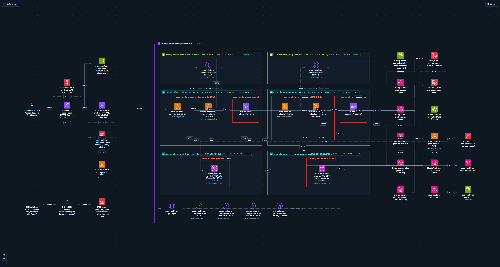
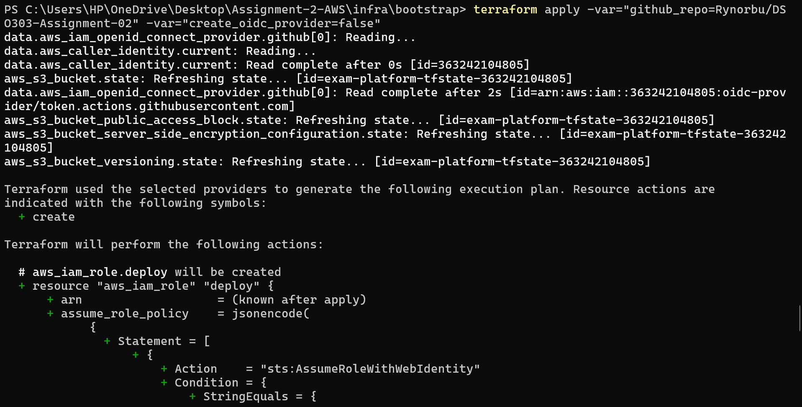
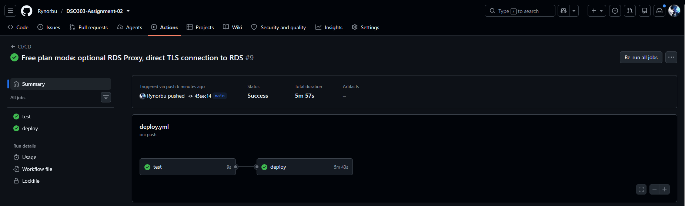
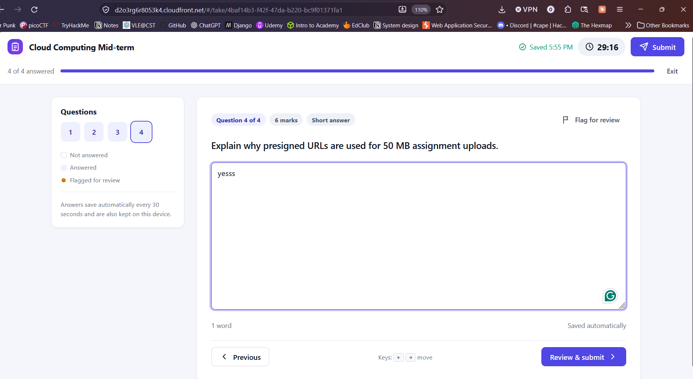
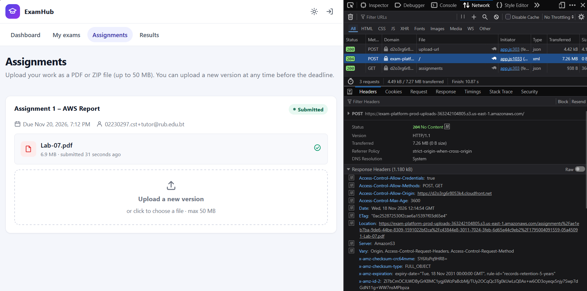
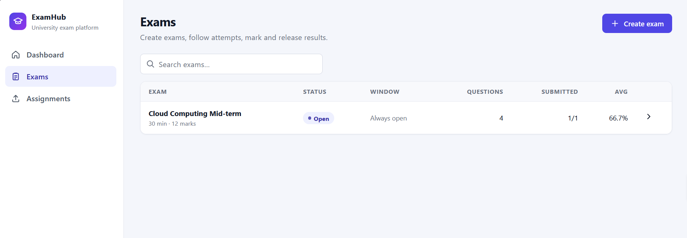

# Online Exam & Assignment Platform on AWS

**DSO303 – Assignment 2 · Cloud Architecture**

A university with **8,000 students and about 400 staff** is moving all exams and assignment submissions online. This repository is the complete solution: the production architecture, the service documentation, the Cloud Architecture Lab build, and a **working deployment on AWS** that is built entirely by **Terraform** and redeployed automatically by **GitHub Actions** on every push to `main`.

| Deliverable | Where |
|---|---|
| **Summary, deploy and tear-down steps** | this file |
| **Architecture diagram and walkthroughs** (+ peak / AZ-loss explanation) | [`architecture/README.md`](architecture/README.md) |
| **Service table** | [`docs/services.md`](docs/services.md) |
| **Evidence** – Cloud Architecture Lab images + AWS screenshots | [`evidence/README.md`](evidence/README.md) |
| Infrastructure as code (Terraform) | [`infra/`](infra) |
| CI/CD pipelines | [`.github/workflows/`](.github/workflows) |
| Application code | [`backend/`](backend) (Lambda, Node.js 22) · [`frontend/`](frontend) (single-page app) |
| Scripts (seed users, failover test, load test) | [`scripts/`](scripts) |

> As agreed with the tutor, **screenshots replace the video**. Every working part is shown below and in [`evidence/`](evidence).

---

## Contents

1. [Summary](#1-summary)
   - [The problem](#11-the-problem)
   - [The solution in one picture](#12-the-solution-in-one-picture)
   - [How each requirement is met](#13-how-each-requirement-is-met)
   - [What was proven](#14-what-was-proven)
   - [AWS Free plan note](#15-aws-free-plan-note)
2. [Deploy](#2-deploy)
3. [Test the deployment](#3-test-the-deployment)
4. [Tear down](#4-tear-down)
5. [Cost](#5-cost)
6. [Repository layout](#6-repository-layout)

---

## 1. Summary

### 1.1 The problem

| | |
|---|---|
| **Users** | Students sit timed exams and upload assignments · Tutors create exams, mark and release results · Admins manage users and schedules |
| **Features** | Role-based sign-in · timed MCQ + short-answer exams · **autosave every 30 s** · **auto-marking of MCQs** · uploads (PDF/ZIP **≤ 50 MB**) · **email when results are released** |
| **Load** | 300–500 concurrent users normally · **3,000 students start one exam within 5 minutes** at peak |
| **Targets** | **99.9 %** availability · **survives loss of one AZ** · **RPO ≤ 5 min** · **RTO ≤ 1 h** · **records kept 5 years** · **encryption in transit and at rest** |

### 1.2 The solution in one picture

A **serverless** design in `us-east-1`, spread across **two Availability Zones** (us-east-1a and us-east-1b):



```
Browser ─► Route 53 ─► CloudFront + WAF ─┬─► S3 (website)
                                          └─► /api/* ─► API Gateway (Cognito JWT) ─► Lambda (private subnets, AZ A + AZ B)
                                                                                        │ TLS
                                    RDS PostgreSQL Multi-AZ (primary AZ A ⇄ synchronous standby AZ B) ◄─┘
Student ─► presigned POST ─► S3 uploads (KMS, lifecycle 5 y) ─► SQS ─► Lambda ─► SQS ─► Lambda ─► SES email
Submit / release ─► SQS marking ─► Lambda (auto-mark, email)          EventBridge every 1 min ─► auto-submit
```

| Tier | AWS services |
|---|---|
| Edge | Route 53 (DNS), CloudFront (CDN), WAF |
| Frontend | S3 website bucket (private, read only by CloudFront) |
| Sign-in | Cognito – groups `students`, `tutors`, `admins` |
| API & compute | API Gateway HTTP API + Lambda functions in **private subnets in both AZs** |
| Database | RDS PostgreSQL 16 **Multi-AZ** in **private data subnets** (not public) |
| Files | S3 uploads bucket – KMS-encrypted, versioned, **lifecycle rules for 5 years** |
| Async | SQS queues + dead-letter queues, EventBridge, SES |
| Network | VPC `10.20.0.0/16`, 6 subnets in 2 AZs, 1 NAT gateway per AZ, VPC endpoints, security groups |
| Security & ops | KMS, Secrets Manager, IAM, CloudWatch, SNS, CloudTrail, AWS Backup |
| CI/CD | GitHub Actions → OIDC → Terraform (state in S3) |

➡️ Full diagram, both walkthroughs and the peak / AZ explanation: [`architecture/README.md`](architecture/README.md) · every service explained: [`docs/services.md`](docs/services.md)

### 1.3 How each requirement is met

| Requirement | How the design meets it |
|---|---|
| Role-based sign-in | Cognito groups go into the JWT; API Gateway validates the token and each route checks the group |
| Timed exams | The deadline is stored **on the server**; EventBridge auto-submits expired attempts every minute |
| Autosave every 30 s | `PUT /api/attempts/{id}/answers` every 30 s, plus a local copy in the browser if the network drops |
| Auto-marking of MCQs | SQS marking queue → marking Lambda |
| 50 MB PDF/ZIP uploads | S3 **presigned POST** with a 50 MB limit – files go straight to S3, never through the API |
| Email on results release | Marking Lambda → SQS notify queue → notify Lambda → **SES** |
| 3,000 starts in 5 minutes | CloudFront caching, Lambda auto-scaling, API throttling (burst 5,000), SQS buffering, RDS Proxy pooling in exam week |
| 99.9 % / loss of one AZ | Every tier in 2 AZs; **RDS Multi-AZ** automatic failover (1–2 min); one NAT per AZ |
| RPO ≤ 5 min / RTO ≤ 1 h | Synchronous standby (RPO ≈ 0 on AZ loss); point-in-time restore (≈ 5 min RPO); AWS Backup; Terraform rebuild ≈ 20 min |
| Records for 5 years | S3 lifecycle: Standard-IA (30 d) → Glacier IR (180 d) → Deep Archive (365 d) → delete (5 y); monthly backups kept 1,825 days |
| Encryption | In transit: TLS everywhere (CloudFront, API, `rds.force_ssl`, S3 TLS-only). At rest: **KMS key** for RDS, S3, secrets, backups |

### 1.4 What was proven

| Rubric item | Result | Evidence |
|---|---|---|
| Full build in the Cloud Architecture Lab | | [`full-architecture.png`](evidence/architecture/full-architecture.png) |
| Lab – Walkthrough 1 (exam + autosave) | HTTP 200 | [`walkthrough-exam-autosave.png`](evidence/architecture/walkthrough-exam-autosave.png) |
| Lab – Walkthrough 2 (40 MB upload + notify) | HTTP 202 | [`upload-notify.png`](evidence/architecture/upload-notify.png) |
| Lab – loss of AZ us-east-1a | served from AZ B + DB failover | [`az-failure.png`](evidence/architecture/az-failure.png) |
| AWS – frontend + sign-in | | [`app-login-page.png`](evidence/aws-app/app-login-page.png) |
| AWS – API + 30 s autosave | | [`autosave-saved.png`](evidence/aws-app/autosave-saved.png) |
| AWS – two-AZ database (real failover) | | [`before-failover.png`](evidence/aws-app/before-failover.png) → [`after-failover.png`](evidence/aws-app/after-failover.png) |
| AWS – S3 uploads | | [`upload-direct-to-s3.png`](evidence/aws-app/upload-direct-to-s3.png) |
| AWS – async step (SQS → Lambda → SES) | | [`auto-marked.png`](evidence/aws-app/auto-marked.png), [`tutor-email.png`](evidence/aws-app/tutor-email.png) |
| IaC + CI/CD – push to `main` redeploys | | [`pipeline.png`](evidence/CI/CD/pipeline.png), [`steps-summary.png`](evidence/CI/CD/steps-summary.png) |
| Tear down from code | | [`teardown-success.png`](evidence/aws-console/teardown-success.png) |

**The architecture built and simulated in the Cloud Architecture Lab:**


| Walkthrough 1 – exam + autosave (HTTP 200) | Walkthrough 2 – upload + notify (HTTP 202) | Loss of us-east-1a (still HTTP 200) |
|---|---|---|
|  |  |  |

### 1.5 AWS Free plan note

The demo account is on the **AWS Free plan**, which blocks two production features. Optional GitHub variables switch the deployment into a Free-plan mode; the architecture and its guarantees stay the same.

| Setting | Production | Deployed demo | Effect |
|---|---|---|---|
| RDS Proxy (`DB_USE_RDS_PROXY`) | On | `false` | Lambdas connect directly to RDS over TLS (1 connection each). Proxy is switched on for exam week on a paid plan |
| Backup retention (`DB_BACKUP_RETENTION_DAYS`) | 7 days | `1` | Point-in-time restore still gives ≈ 5 min RPO; 5-year records come from AWS Backup + S3 lifecycle |
| Custom domain (Route 53 + ACM) | `exams.uni.ac.uk` | CloudFront domain | Same HTTPS path, no custom name |
| Multi-AZ database (`DB_MULTI_AZ`) | On | **On** | Survives the loss of one AZ |

---

## 2. Deploy

The whole stack is created from code. You run **one bootstrap command once**, set **GitHub variables**, and then **every push to `main` deploys automatically**.

```
 Step 1          Step 2              Step 3            Step 4              Step 5
 Tools ready ─► Bootstrap (once) ─► GitHub vars ─►  git push main ─►  Confirm emails + seed users
```

### Step 1 – Prepare your tools

You need:

- An **AWS account** and the **AWS CLI** signed in with an administrator user
- **Terraform 1.10+**, **Node.js 20+**, **Git**, and a **GitHub repository** for this code
- An **email address** you can read (for SES and alarm emails)

Check that the AWS CLI is signed in to the right account:

```bash
aws sts get-caller-identity
```


> **New accounts:** Lambda concurrency may be limited to 10 – enough for the demo. SES starts in **sandbox** mode, so every email recipient must be verified first (that is what `SES_TEST_RECIPIENTS` is for).

### Step 2 – Bootstrap (one time only)

This creates the **S3 bucket for Terraform state** and the **IAM role that GitHub Actions uses through OIDC** (so no AWS keys are ever stored in GitHub).

```bash
cd infra/bootstrap
terraform init
terraform apply -var="github_repo=<github-user>/<repo-name>"
```

> If the account already has a GitHub OIDC provider, add `-var="create_oidc_provider=false"`.

Write down the two outputs: **`state_bucket`** and **`deploy_role_arn`**.



### Step 3 – Add the GitHub variables

In GitHub go to **Settings → Secrets and variables → Actions → Variables → New repository variable** and add:

| Variable | Value | Example |
|---|---|---|
| `AWS_DEPLOY_ROLE_ARN` | `deploy_role_arn` from Step 2 | `arn:aws:iam::123456789012:role/exam-platform-github-deploy` |
| `TF_STATE_BUCKET` | `state_bucket` from Step 2 | `exam-platform-tfstate-123456789012` |
| `AWS_REGION` | AWS region | `us-east-1` |
| `SES_SENDER_EMAIL` | address the emails come from | `you@example.com` |
| `SES_TEST_RECIPIENTS` | JSON list of test inboxes | `["student@example.com","tutor@example.com"]` |
| `ALARM_EMAIL` | where CloudWatch alarms go | `you@example.com` |
| `DB_USE_RDS_PROXY` *(Free plan only)* | turn off RDS Proxy | `false` |
| `DB_BACKUP_RETENTION_DAYS` *(Free plan only)* | backup days allowed | `1` |


### Step 4 – Push to `main`

```bash
git add .
git commit -m "Deploy exam platform"
git push origin main
```

This starts the **CI/CD** workflow ([`.github/workflows/deploy.yml`](.github/workflows/deploy.yml)):

| # | Job / step | What it does |
|---|---|---|
| 1 | **test** | `npm test` (unit tests) and a frontend syntax check |
| 2 | Configure AWS credentials (OIDC) | GitHub gets short-lived AWS credentials – no stored keys |
| 3 | Terraform fmt → init → validate → **plan** | Checks the code and shows exactly what will change |
| 4 | **Terraform apply** | Creates or updates every AWS resource |
| 5 | Invalidate CloudFront cache | Users get the new website straight away |
| 6 | **Smoke test** | Calls `/api/health` to prove the API works |

The first deploy takes **about 20–25 minutes** (RDS Multi-AZ and CloudFront are slow to create). After that, **every push to `main` redeploys automatically**. Pull requests run tests and the plan only.

| Pipeline triggered by the push | Every deploy step green |
|---|---|
|  |  |


When it finishes, the outputs show the app URL, both AZs, the database and the Cognito pool. The `migration_result` shows the tables were created:

```bash
cd infra
terraform init -backend-config="bucket=<state_bucket>" -backend-config="region=us-east-1"
terraform output
```


### Step 5 – Confirm emails and create users

1. **Confirm the emails.** Open your inbox and click every **AWS SES verification** link and the **SNS alarm subscription** link.

   | SNS alarm subscription confirmed | SES identities verified |
   |---|---|
   |  |  |

2. **Create one admin, one tutor and one student** in Cognito (use Git Bash on Windows):

   ```bash
   bash scripts/seed-users.sh admin@example.com tutor@example.com student@example.com 'Passw0rd1234'
   ```

   The script prints the app URL to sign in at:

   

3. **Open the app URL** (`https://<id>.cloudfront.net`) and sign in.

   

<details>
<summary><b>Alternative: deploy from your laptop instead of GitHub</b></summary>

```bash
cd backend && npm ci --omit=dev && cd ../infra
cp example.tfvars terraform.tfvars        # edit the emails
terraform init -backend-config="bucket=<state_bucket>" -backend-config="region=us-east-1"
terraform apply
```
</details>

<details>
<summary><b>Run everything locally (no AWS needed)</b></summary>

Needs Docker Desktop and Node.js 20+. The same Lambda code runs against PostgreSQL 16 in Docker; queues, file storage and email are emulated.

```powershell
docker compose up -d          # PostgreSQL 16 on localhost:55432
cd backend
npm install
npm test                      # unit tests
npm run local                 # http://localhost:3000
```

Uploads go to `local-data/uploads`, emails to `local-data/outbox`. Stop with `Ctrl+C` and `docker compose down`.
</details>

---

## 3. Test the deployment

| # | Flow | How to test | Result |
|---|---|---|---|
| 1 | **Exam + autosave** | Tutor creates an exam (sample questions are pre-filled). Student starts it and answers | "Saved hh:mm:ss" every 30 s; refresh restores the answers |
| 2 | **Upload + notify** | Student uploads a PDF/ZIP on the Assignments card | File goes straight to S3; tutor gets an email |
| 3 | **Marking + results** | Student submits; tutor marks short answers and clicks *Release results* | MCQs auto-marked; students get an email |
| 4 | **AZ failure** | `bash scripts/az-failover-test.sh` | RDS fails over to the other AZ; app keeps working |
| 5 | **Peak load** | `node scripts/load-test.mjs <app_url> <client_id> us-east-1 <student> <password> <exam_id> 3000 100` | Autosaves succeed under load |

**1 – Exam and autosave**

| Tutor creates the exam | Student's answers autosaved |
|---|---|
|  |  |

**2 – 40 MB upload and tutor notified**

| Upload goes straight to S3 | Tutor receives the email |
|---|---|
|  |  |

**3 – Auto-marking and results**

| MCQs auto-marked by the marking Lambda | Results released to students |
|---|---|
|  |  |

**4 – Loss of an AZ (real RDS Multi-AZ failover)**

| Before: primary in one AZ | After: primary moved to the other AZ |
|---|---|
|  |  |

RDS logged the failover ([`rds-events.png`](evidence/aws-app/rds-events.png)) and SNS emailed the team ([`mail-on-multiAZs.png`](evidence/aws-app/mail-on-multiAZs.png)).

**5 – Peak load**


More screenshots of every AWS component (VPC, subnets, NAT, security groups, RDS, Lambda, API Gateway, WAF, S3, SQS, KMS, CloudWatch, …) are in the [evidence report](evidence/README.md).

---

## 4. Tear down

> ⚠️ The stack costs about **$4–5 per day** (mainly NAT gateways and Multi-AZ RDS). Destroy it as soon as you have your evidence.

### Step 1 – Commit your last changes without redeploying

Add `[skip ci]` to the message so the push does **not** start a new deploy:

```bash
git add -A
git commit -m "Final evidence [skip ci]"
git push
```

### Step 2 – Run the Tear down workflow

1. In GitHub open **Actions → Tear down → Run workflow**.
2. Type **`DESTROY`** in the confirmation box and click **Run workflow**.
3. Wait about **20 minutes** (deleting Multi-AZ RDS, CloudFront and the NAT gateways is slow) until the run shows a green tick.

The workflow ([`.github/workflows/destroy.yml`](.github/workflows/destroy.yml)) signs in with OIDC and runs `terraform destroy -auto-approve`:


<details>
<summary><b>Alternative: destroy from your laptop</b></summary>

```bash
cd backend && npm ci --omit=dev && cd ../infra
terraform destroy
```
</details>

### Step 3 – Check that nothing is left

In the AWS Console (region **N. Virginia / us-east-1**) check that there is nothing named `exam-platform-prod` in:

- **RDS → Databases**
- **VPC → NAT gateways** and **Elastic IPs**
- **Lambda → Functions**
- **CloudFront → Distributions**

| VPC → NAT gateways | RDS → Databases |
|---|---|
|  |  |

No `exam-platform-prod` NAT gateways or databases remain. The `yonten-*` resources shown belong to another student's project in the shared class account and were left untouched.

### Step 4 – (Optional) Remove the bootstrap

The state bucket and the OIDC role cost nothing, so keep them until the assignment is marked. To remove them later, empty the state bucket (all versions) and run:

```bash
cd infra/bootstrap
terraform destroy -var="github_repo=<github-user>/<repo-name>"
```

**Notes**
- Demo defaults (`db_deletion_protection = false`, `force_destroy = true` on buckets) make the destroy clean. For real production set `db_deletion_protection = true`.
- The KMS key goes into a **7-day pending-deletion** window (no charge).

---

## 5. Cost

| Item (demo, us-east-1) | ≈ per day |
|---|---|
| RDS `db.t4g.micro` Multi-AZ | $1.60 |
| 2 NAT gateways (one per AZ) | $2.20 |
| SQS interface endpoint (2 AZs) | $0.50 |
| WAF web ACL + rules | $0.30 |
| Lambda, API Gateway, S3, SQS, SES, CloudFront at demo volume | ≈ $0 (free tier) |
| **Total** | **≈ $4–5** |

---

## 6. Repository layout

```
README.md           summary, deploy and tear-down steps (this file)
architecture/       diagram (PNG + Mermaid), two walkthroughs, peak/AZ explanation, lab/ JSON files
docs/services.md    service table (role, why over an alternative, connects to, configuration)
evidence/           Cloud Architecture Lab images + AWS, CI/CD and Terraform screenshots
infra/              Terraform: network, database, storage, auth, compute, api, edge, monitoring, backup
infra/bootstrap/    Terraform state bucket + GitHub OIDC deploy role
backend/            Lambda handlers, schema.sql, unit tests
frontend/           index.html, app.js, styles.css
scripts/            seed-users.sh, az-failover-test.sh, load-test.mjs
.github/workflows/  deploy.yml (CI/CD), destroy.yml (tear down)
```
