# Online Exam and Assignment Platform on AWS

**DSO303 Assignment 2** | Region: **us-east-1 (N. Virginia)** | Built with **Terraform** and deployed by **GitHub Actions**

A university with **8,000 students and about 400 staff** is moving every exam and assignment submission online. As the cloud architect, I designed the production platform, documented every service, built and simulated it in the Cloud Architecture Lab, and **deployed it for real on AWS** – built entirely from Terraform and redeployed by GitHub Actions on every push to `main`.

---

## Contents

1. [The task](#1-the-task)
2. [The answer in short](#2-the-answer-in-short)
3. [Architecture](#3-architecture)
4. [Two request walkthroughs](#4-two-request-walkthroughs)
5. [Exam peak and the loss of one AZ](#5-exam-peak-and-the-loss-of-one-az)
6. [Cloud Architecture Lab](#6-cloud-architecture-lab)
7. [The platform working on AWS](#7-the-platform-working-on-aws)
8. [Infrastructure as code and CI/CD](#8-infrastructure-as-code-and-cicd)
9. [How I did the work](#9-how-i-did-the-work)
10. [Detailed reports and evidence](#10-detailed-reports-and-evidence)
11. [How I deployed it](#11-how-i-deployed-it)
12. [How I tore it down](#12-how-i-tore-it-down)
13. [Cost](#13-cost)

---

## 1. The task

| | What the university needs |
|---|---|
| **Users** | Students sit timed exams and upload assignments. Tutors create exams, mark them and release results. Administrators manage users and schedules. |
| **Features** | Role-based sign-in, timed MCQ and short-answer exams, **answers autosaved every 30 seconds**, **auto-marking of MCQs**, **file uploads (PDF or ZIP, up to 50 MB)**, and **email when results are released** |
| **Load** | 300 to 500 users at once normally. At exam-week peak, **3,000 students start one exam within 5 minutes**. |
| **Targets** | **99.9 %** availability during exams, **survive the loss of one Availability Zone**, lose at most **5 minutes** of answers (RPO), be back within **1 hour** (RTO), keep records for **5 years**, and **encrypt** data in transit and at rest |

The assignment has three tasks:

| Task | Delivered in |
|---|---|
| **1. Architecture design** – full production diagram, two walkthroughs, peak and AZ-loss explanation | [`architecture/README.md`](architecture/README.md) |
| **2. Service documentation** – every service with its role, why it beats an alternative, what it connects to and its configuration | [`docs/services.md`](docs/services.md) |
| **3. Implementation** – Cloud Architecture Lab build and simulations, plus a real AWS deployment | [`evidence/README.md`](evidence/README.md) |

---

## 2. The answer in short

**Verdict: the design meets every requirement.** I built it in the Cloud Architecture Lab, deployed it for real on AWS, tested it (including a real database failover), and tore it down again – all from code.

| Requirement | Target | Result | Status |
|---|---|---|---|
| Role-based sign-in | students, tutors, admins | Cognito groups checked by API Gateway before any code runs | Met |
| Autosave | every 30 seconds | "Saved hh:mm:ss" on screen; answers written to the Multi-AZ database | Met |
| Auto-marking | MCQs marked automatically | SQS marking queue and marking Lambda scored the MCQs (6 / 6) | Met |
| Uploads | PDF or ZIP up to 50 MB | Presigned POST straight to S3 with a 50 MB limit, encrypted with KMS | Met |
| Email on release | students and tutors emailed | SQS notify queue, notify Lambda and SES delivered the emails | Met |
| Exam peak | 3,000 starts in 5 minutes | Serverless scaling, CloudFront caching, API throttling and SQS buffering. Load test reached 55.8 requests per second; the only limit hit was the new account's Lambda quota (see [§7.6](#76-peak-load-test)) | Met by design |
| Lose one AZ | keep running | **Real failover tested:** the database moved to the other AZ and was back in **61 seconds**, with only 2 failed health checks | Met |
| Data loss (RPO) | at most 5 minutes | **0** for an AZ failure (synchronous standby); about 5 minutes for corruption (point-in-time restore) | Met |
| Recovery time (RTO) | at most 1 hour | **61 seconds** for an AZ failure; under 1 hour for a restore; about 20 minutes to rebuild from Terraform | Met |
| Keep records | 5 years | S3 lifecycle rules and AWS Backup monthly copies kept 1,825 days | Met |
| Encryption | in transit and at rest | TLS everywhere; one KMS key for the database, files, secrets and backups | Met |

**Key numbers**

| | |
|---|---|
| Availability Zones used | **2** (us-east-1a and us-east-1b) for every tier |
| Lab simulations | Walkthrough 1 **HTTP 200** in 138 ms · Walkthrough 2 **HTTP 202** · loss of us-east-1a **HTTP 200** |
| Real database failover | **61 seconds**, primary moved from us-east-1b to us-east-1a |
| Deploy from a push to `main` | about **6 minutes** for an update, 20 to 25 minutes for the first build |
| Demo cost | about **$4 to $5 a day**, torn down as soon as the evidence was taken |

---

## 3. Architecture

**The full production architecture, built in the Cloud Architecture Lab**

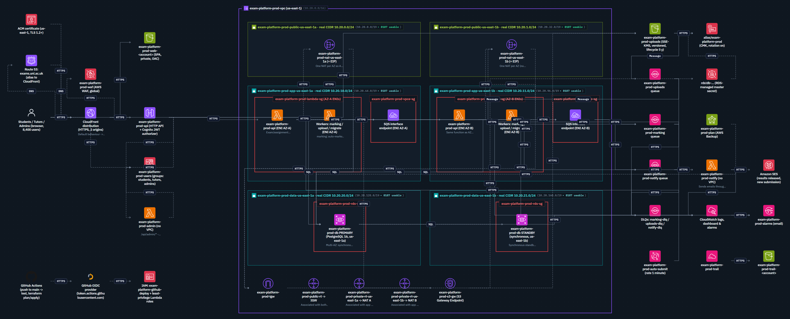

**How a request travels:** student - CloudFront and WAF - API Gateway (token checked with Cognito) - Lambda in a private subnet in either AZ - RDS PostgreSQL primary, copied synchronously to a standby in the other AZ.

**How a file travels:** student - S3 uploads bucket (directly, with a presigned POST) - SQS uploads queue - upload Lambda - SQS notify queue - notify Lambda - SES email to the tutor.

| Tier | AWS services | Where it runs |
|---|---|---|
| Edge | Route 53 (DNS), CloudFront (CDN), AWS WAF | Global |
| Frontend | S3 website bucket, readable only by CloudFront | Regional |
| Sign-in | Cognito user pool with `students`, `tutors` and `admins` groups | Regional, multi-AZ |
| API and compute | API Gateway HTTP API, six Lambda functions (Node.js 22, arm64) | Lambdas in **private app subnets in both AZs** |
| Database | RDS PostgreSQL 16 **Multi-AZ** – primary in one AZ, synchronous standby in the other | **Private data subnets**, no public access |
| File storage | S3 uploads bucket – KMS-encrypted, versioned, **lifecycle rules for 5 years** | Regional (3+ AZs) |
| Async processing | SQS marking, uploads and notify queues with dead-letter queues, EventBridge, SES | Regional, multi-AZ |
| Network | VPC `10.20.0.0/16`, 6 subnets in 2 AZs, internet gateway, **one NAT gateway per AZ**, S3 and SQS endpoints, security groups | 2 AZs |
| Secrets and security | KMS key, Secrets Manager, IAM least-privilege roles, CloudTrail | Regional |
| Monitoring | CloudWatch logs, alarms and dashboard, SNS email, RDS event subscription | Regional |
| CI/CD | GitHub Actions, OIDC role (no stored keys), Terraform with state in S3 | – |

**Security in one line:** the database accepts connections only from the Lambda security group, the Lambda security group accepts nothing from outside, and nothing in the VPC is open to the internet.

Full details, every tier with its own diagram: [Architecture report](architecture/README.md) · every service justified: [Service documentation](docs/services.md)

---

## 4. Two request walkthroughs

### Walkthrough 1 – a student opens an exam and answers autosave

1. The website loads from the **CloudFront** cache (or the private **S3** bucket); **WAF** checks every request.
2. The student signs in with **Cognito** and receives a token for the `students` group.
3. **Start exam** calls the API. **API Gateway** checks the token, then runs the **api Lambda** in a private subnet.
4. The Lambda reads the database password from **Secrets Manager** and connects to **RDS over TLS**. It creates the attempt with a **deadline stored on the server**.
5. **Every 30 seconds** the browser saves the answers. RDS writes them and **copies them to the standby in the other AZ** before confirming. The screen shows *"Saved 10:41:30"*.
6. If the network drops, answers stay in the browser and are sent on the next save. On **Submit**, an **SQS** message triggers the marking Lambda; **EventBridge** auto-submits attempts whose time has run out.

**Simulated in the lab: HTTP 200 in 138 ms, all 11 steps passed**

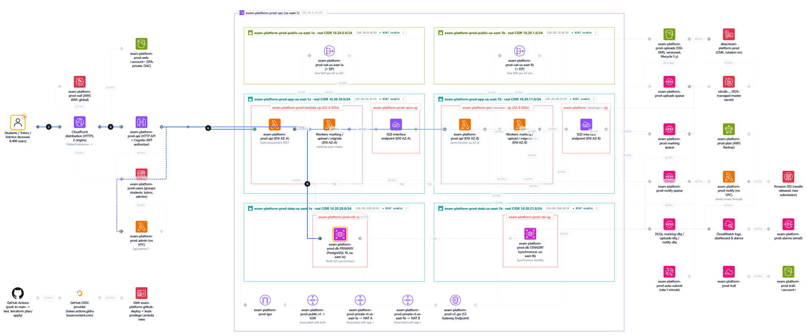

### Walkthrough 2 – a student uploads a 40 MB assignment and the tutor is notified

1. The browser asks the API for an upload link. The api Lambda checks the file type and returns an **S3 presigned POST** limited to **50 MB**.
2. The 40 MB file goes **directly from the browser to S3** – never through API Gateway (10 MB limit) or Lambda (6 MB limit). S3 encrypts it with **KMS**.
3. S3 sends an event to the **SQS uploads queue**. The **upload Lambda** records the submission in **RDS** and puts an email job on the **SQS notify queue**.
4. The **notify Lambda** sends the tutor an email through **SES**: *"New submission: Assignment 1 – report.pdf"*.
5. Failed messages are retried 5 times, then moved to a **dead-letter queue** and a CloudWatch alarm emails the team.
6. **Lifecycle rules** move the file to cheaper storage over time and delete it after 5 years.

**Simulated in the lab: HTTP 202 Accepted, all 8 steps passed**

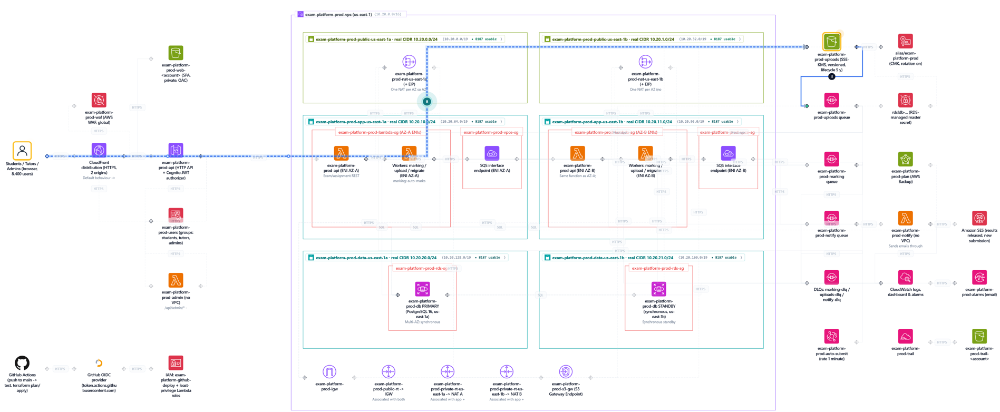

The step-by-step tables and every timeline screenshot are in the [architecture report](architecture/README.md#3-walkthrough-1--a-student-opens-an-exam-and-answers-autosave).

---

## 5. Exam peak and the loss of one AZ

| Situation | How the design copes |
|---|---|
| **3,000 students start in 5 minutes** (about 10 starts and 100 autosaves a second) | CloudFront serves the website from the edge. API Gateway and Lambda scale automatically – the peak needs only about 20 Lambdas at once. API throttling (burst 5,000) absorbs spikes. RDS Proxy and a larger database (`db.m6g.large`) are switched on for exam week. Marking, emails and uploads wait in SQS queues, so they never slow down students who are writing. |
| **One Availability Zone fails** | Lambdas already run in both AZs, so new requests go to the healthy one. API Gateway, Cognito, S3, SQS, SES and CloudFront are regional or global and keep working. RDS Multi-AZ promotes the standby in about 1 to 2 minutes with **no confirmed answers lost**. Each AZ has its own NAT gateway. The browser keeps answers and retries, and the deadline is on the server, so students lose neither work nor time. |
| **Data is corrupted** | Point-in-time restore (about 5 minutes of data loss) and AWS Backup recover within the 1-hour RTO. |

**Simulated in the lab: us-east-1a fails, the autosave is served from AZ B and the database fails over – still HTTP 200**

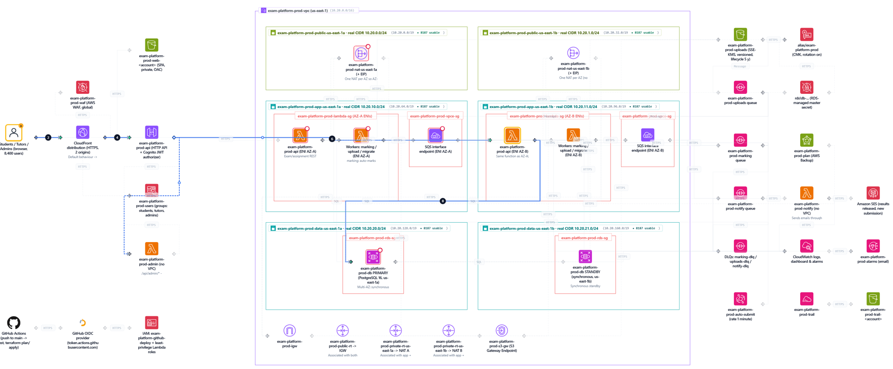

The full answer (283 words, within the 300-word limit) is in the [architecture report](architecture/README.md#5-how-the-design-handles-the-exam-peak-and-the-loss-of-one-az--300-words).

---

## 6. Cloud Architecture Lab

I built the whole production architecture in the Cloud Architecture Lab, then simulated both walkthroughs and the loss of one AZ.

| Simulation | What was sent | Result |
|---|---|---|
| Walkthrough 1 – exam and autosave | `GET /api/exams` and `PUT /api/attempts/{id}/answers` | **HTTP 200** in 138 ms, 11 / 11 steps |
| Walkthrough 2 – upload and notify | `POST /assignments/{id}/report.pdf` | **HTTP 202**, 8 / 8 steps |
| Loss of us-east-1a | autosave with every resource in us-east-1a failed | **HTTP 200**, served from AZ B, "Multi-AZ Automated Database Failover" |

**Loss of us-east-1a: API Gateway uses the Lambda in AZ B and the database fails over**

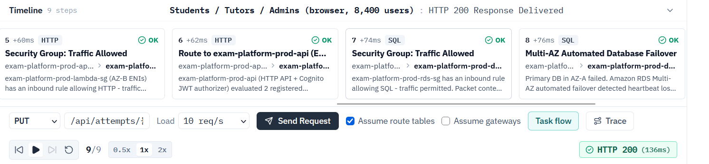

The four lab files can be imported again from [`architecture/lab/`](architecture/lab). Every lab screenshot: [Evidence §1](evidence/README.md#1-cloud-architecture-lab).

---

## 7. The platform working on AWS

The rubric asks for the **frontend, API, two-AZ database, S3 uploads and the async step** working. I deployed and tested each one in us-east-1 on 18 November 2026.

| Part | What was shown | Result |
|---|---|---|
| Frontend | App served over HTTPS from CloudFront, sign-in with Cognito | Working |
| API | Tutor creates an exam; student's answers autosave every 30 s | Working |
| Two-AZ database | Forced RDS Multi-AZ failover while the app was in use | Back in 61 s |
| S3 uploads | File uploaded straight to S3 with a presigned POST, stored with SSE-KMS | Working |
| Async step | SQS marking queue auto-marked MCQs; S3 event, SQS and SES emailed the tutor | Working |

### 7.1 Frontend and sign-in

**The login page, served over HTTPS by CloudFront**

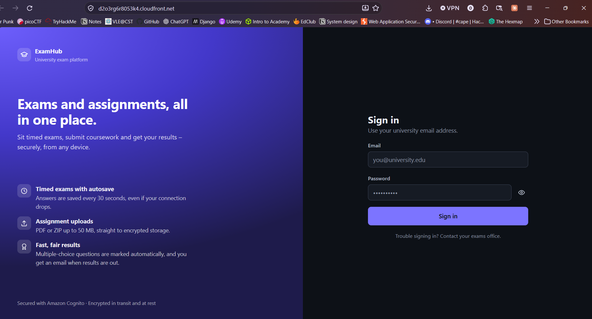

### 7.2 API and autosave

**A student's answers autosaved – "Saved hh:mm:ss" every 30 seconds**


### 7.3 Two-AZ database – a real failover

`scripts/az-failover-test.sh` rebooted the database with a forced failover while checking `/api/health` every 2 seconds. Only **2 health checks failed**, and the database was available again after **61 seconds**. RDS logged *failover started* and *failover completed*.

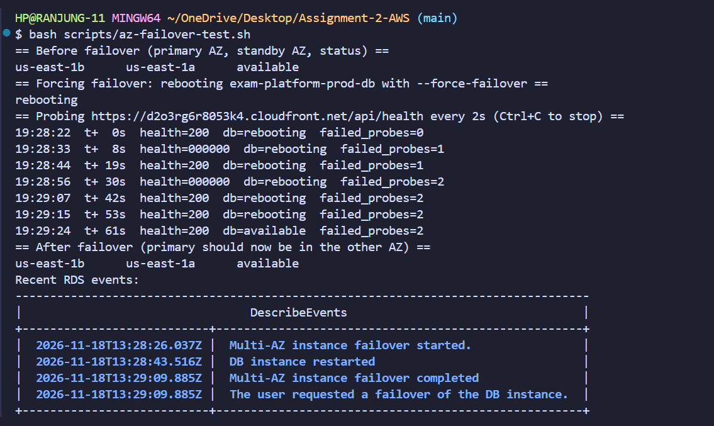

**After the failover the primary is in us-east-1a (it was in us-east-1b before)**

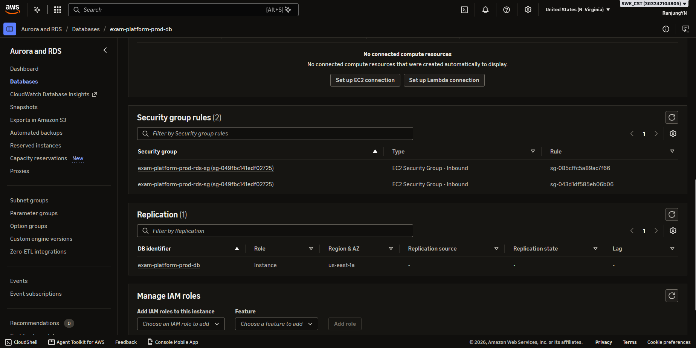

### 7.4 S3 uploads

**The browser's network tab: the file goes to S3, not to the API**


### 7.5 Async step – SQS, Lambda and SES

**MCQs auto-marked by the marking Lambda from the SQS marking queue**

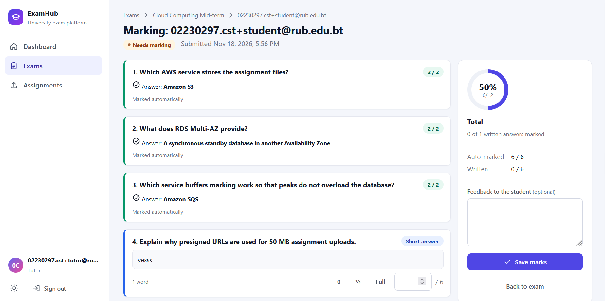

**The tutor receives the "new submission" email from SES**

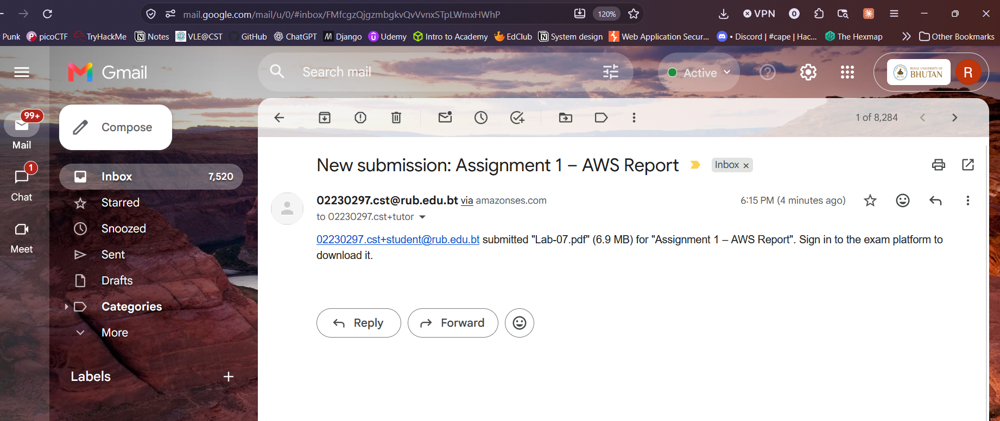

### 7.6 Peak load test

`scripts/load-test.mjs` sent **1,000 autosaves, 50 at a time**, through CloudFront and API Gateway to Lambda and the database.

| Measure | Result |
|---|---|
| Throughput | **55.8 requests per second** (about half the exam-peak autosave rate) |
| Reached Lambda and the database | **963** (96.3 %) – returned 409 *"attempt is closed"*, because the test student had already submitted that exam. The app correctly refused to change a closed attempt. |
| Throttled | **37** (3.7 %) – HTTP 503 from the **new account's Lambda limit of 10 at once** |
| Response time | median 446 ms, p95 4.3 s |

**What it shows:** every layer carried the traffic, and the only bottleneck was the account quota. The **CloudWatch throttle alarm fired and emailed the team**, which is exactly why the design raises the Lambda concurrency quota and switches on RDS Proxy before exam week.

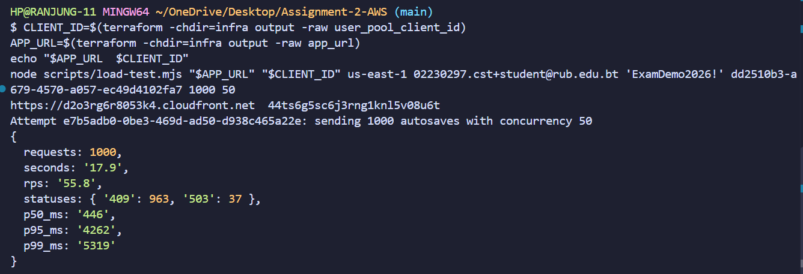

Every AWS component (VPC, subnets, NAT, security groups, RDS, Lambda, API Gateway, WAF, S3, SQS, KMS, CloudWatch and more) has its own screenshot: [Evidence §3](evidence/README.md#3-aws-deployment--every-component-in-the-console).

---

## 8. Infrastructure as code and CI/CD

- **Fully reproducible from code.** I wrote every resource in Terraform in [`infra/`](infra) – network, database, storage, sign-in, compute, API, edge, monitoring and backup. A one-time bootstrap created the state bucket and the deploy role. Nothing was created by hand in the console.
- **Push to `main` redeploys automatically.** I set up [`deploy.yml`](.github/workflows/deploy.yml) so every push runs the unit tests, then Terraform fmt, init, validate, plan and **apply**, then clears the CloudFront cache and runs a smoke test.
- **No stored AWS keys.** GitHub signs in to AWS with **OIDC** through a role that only my repository can use.
- **Tear down from code.** I added [`destroy.yml`](.github/workflows/destroy.yml), which runs `terraform destroy` once `DESTROY` is typed.

**My push to `main` started the pipeline, and every step passed**

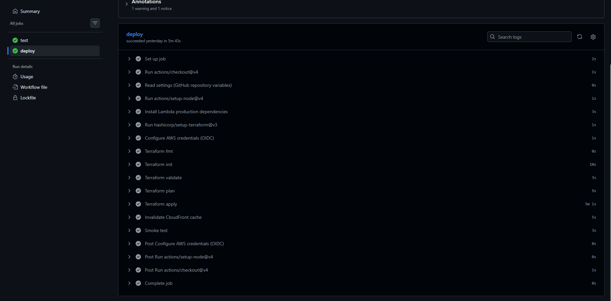

---

## 9. How I did the work

- **I built and tested it for real.** I deployed the stack to us-east-1 with Terraform through GitHub Actions, tested it on 18 November 2026, and then tore it down with the *Tear down* workflow.
- **I tested locally first.** The same Lambda code runs on my laptop against PostgreSQL in Docker, with 6 unit tests ([Evidence §5](evidence/README.md#5-local-run-supporting)).
- **Screenshots instead of a video.** As agreed with my tutor, my evidence is screenshots – 124 of them, each with a short explanation.
- **Limits of the class account.** The account is on the AWS Free plan, which refused two things:
  - RDS Proxy;
  - backup retention longer than 1 day.

  I added three GitHub variables that switch the deployment into a Free-plan mode **without changing the architecture**: Lambdas connect directly to RDS over TLS with one connection each, and backups are kept 1 day. Multi-AZ stayed on. My design and service table describe the **full production setup**, with RDS Proxy, 7-day backups and a custom domain.

| Setting | Production | What I deployed | Effect on the targets |
|---|---|---|---|
| RDS Proxy (`DB_USE_RDS_PROXY`) | On | `false` | None at demo scale; switched on for exam week |
| Backup retention (`DB_BACKUP_RETENTION_DAYS`) | 7 days | `1` | Point-in-time restore still gives about 5 minutes RPO |
| Multi-AZ database (`DB_MULTI_AZ`) | On | **On** | Survives the loss of one AZ |
| Custom domain (Route 53 and ACM) | `exams.uni.ac.uk` | CloudFront address | Same HTTPS path, no custom name |

---

## 10. Detailed reports and evidence

| Report | What is in it |
|---|---|
| [Architecture](architecture/README.md) | The full diagram, every tier with its own image, both walkthroughs step by step, the peak and AZ-loss answer, the AZ-failure simulation, and the lab files |
| [Service documentation](docs/services.md) | Every service: role, why it was chosen over an alternative, what it connects to, and its configuration |
| [Evidence](evidence/README.md) | All 124 screenshots, each with a title and explanation: lab, app on AWS, every console component, IaC and CI/CD, local run |

---

## 11. How I deployed it

I created the whole stack from code: I ran the bootstrap **once**, set the **GitHub variables**, then **pushed to `main`**.

### Step 1 – I prepared my tools

I used the **AWS CLI** signed in as my IAM user, **Terraform**, **Node.js 22**, **Git** and my GitHub repository. First I checked that the CLI was signed in to the right account:

```bash
aws sts get-caller-identity
```

**The AWS CLI signed in to my account**

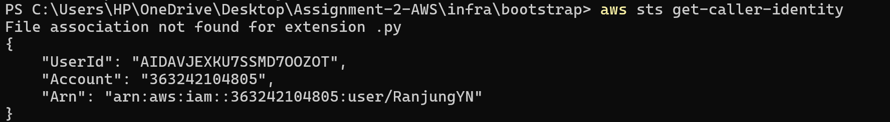

### Step 2 – I ran the bootstrap (once)

The bootstrap created the **S3 bucket for Terraform state** and the **IAM role that GitHub Actions uses through OIDC**. The account already had a GitHub OIDC provider, so I told Terraform not to create another one:

```bash
cd infra/bootstrap
terraform init
terraform apply -var="github_repo=Rynorbu/DSO303-Assignment-02" -var="create_oidc_provider=false"
```

It returned the two values I needed next: **`state_bucket`** and **`deploy_role_arn`**.

**Bootstrap finished: the deploy role and the state bucket**

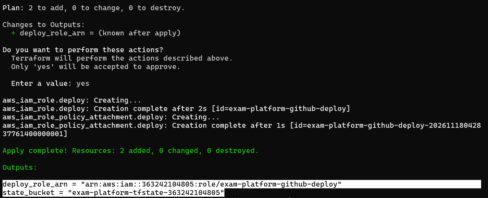

### Step 3 – I added the GitHub variables and pushed to `main`

I added the deploy role, state bucket, Region and email addresses as repository variables (no secrets or keys), and later the two Free-plan variables.

**My repository variables in GitHub**

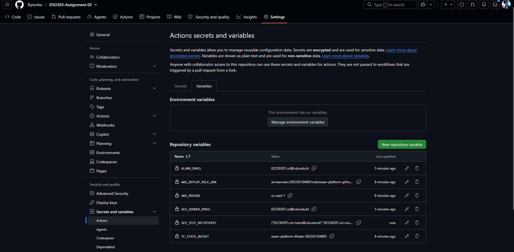

When I pushed to `main`, the **CI/CD** workflow ran:

| # | Step | What it did |
|---|---|---|
| 1 | Unit tests | `npm test` and a frontend syntax check |
| 2 | Sign in with OIDC | Short-lived AWS credentials, no stored keys |
| 3 | Terraform fmt, init, validate, plan | Checked the code and showed what would change |
| 4 | **Terraform apply** | Created or updated every AWS resource |
| 5 | CloudFront invalidation | Made the new website live straight away |
| 6 | Smoke test | Called `/api/health` to prove the API worked |

The first deploy took **20 to 25 minutes** (the Multi-AZ database and CloudFront are slow to create). Later pushes took about **6 minutes**.

**Terraform plan and apply running inside GitHub Actions**

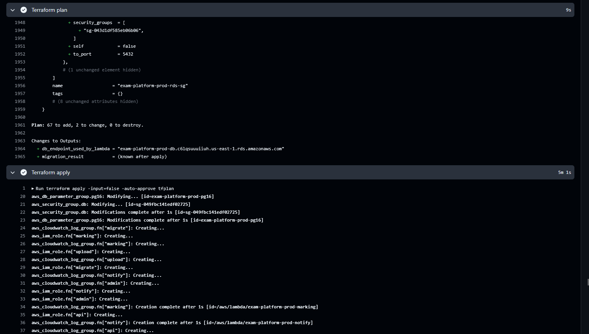

**The stack outputs: the app address, both AZs, the database and the Cognito pool**

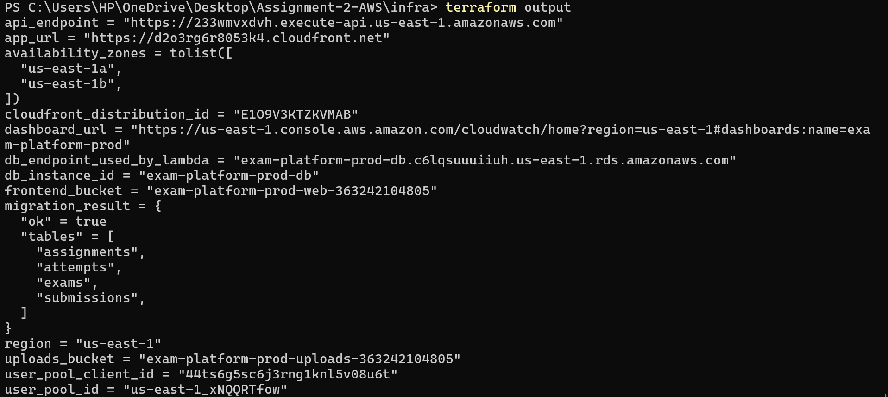

### Step 4 – I confirmed the emails and created the users

1. I clicked the **SES verification** links and the **SNS alarm subscription** link in my inbox.
2. I created one admin, one tutor and one student with my seeding script (in Git Bash):

   ```bash
   bash scripts/seed-users.sh <admin-email> <tutor-email> <student-email> '<password>'
   ```

3. I opened the CloudFront address and signed in as each role.

**The three users created and every email identity verified**

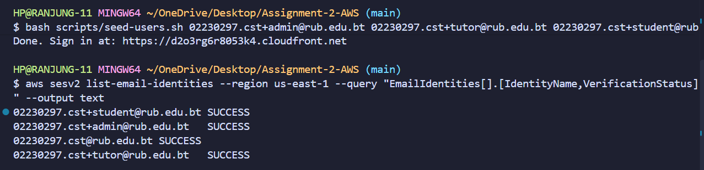

### Step 5 – I tested every flow

| Flow | What I did | What happened |
|---|---|---|
| Exam and autosave | Created an exam as the tutor, then started and answered it as the student | "Saved hh:mm:ss" every 30 s; refreshing kept the answers |
| Upload and notify | Uploaded a PDF as the student | The file went straight to S3 and the tutor got an email |
| Marking and results | Submitted, marked the short answer as the tutor and released results | MCQs were auto-marked and the students were emailed |
| AZ failure | Ran `bash scripts/az-failover-test.sh` | The database moved to the other AZ and was back in 61 s |
| Peak load | Ran `node scripts/load-test.mjs` with 1,000 autosaves, 50 at a time | 55.8 requests per second; only the account's Lambda quota throttled requests ([§7.6](#76-peak-load-test)) |

<details>
<summary><b>Before deploying, I ran everything locally (no AWS needed)</b></summary>

I ran the same Lambda code against PostgreSQL 16 in Docker; queues, file storage and email were emulated.

```powershell
docker compose up -d          # PostgreSQL 16 on localhost:55432
cd backend
npm install
npm test                      # unit tests
npm run local                 # http://localhost:3000
```

Uploads went to `local-data/uploads` and emails to `local-data/outbox`.
</details>

---

## 12. How I tore it down

The stack cost about **$4 to $5 a day**, mainly the NAT gateways and the Multi-AZ database, so I destroyed it as soon as my evidence was taken.

### Step 1 – I committed without redeploying

I put `[skip ci]` in my commit message so the push did **not** start a new deploy:

```bash
git add -A
git commit -m "Final reports and evidence [skip ci]"
git push
```

### Step 2 – I ran the Tear down workflow

In GitHub I opened **Actions - Tear down - Run workflow**, typed **`DESTROY`** and ran it. It signed in with OIDC, ran `terraform destroy`, and finished with a green tick after **22 minutes**.

**My Tear down workflow ran `terraform destroy` successfully**

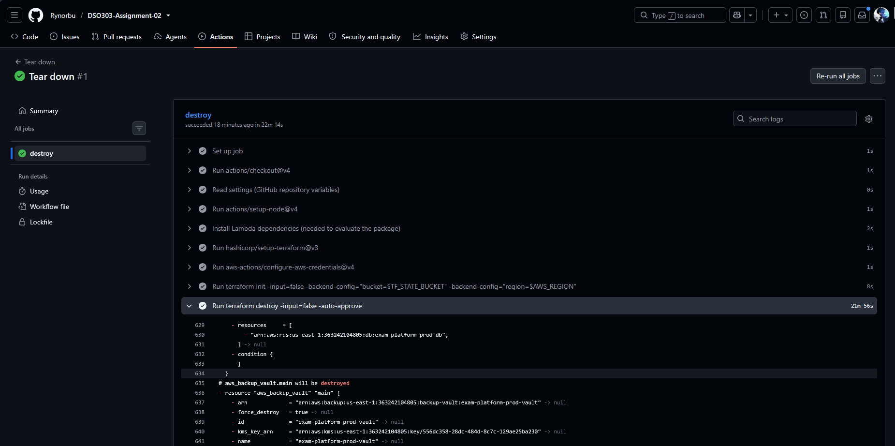

### Step 3 – I checked that nothing was left

In the AWS Console (**N. Virginia**) I checked **RDS - Databases**, **VPC - NAT gateways** and **Elastic IPs**, **Lambda - Functions** and **CloudFront - Distributions**. Nothing named `exam-platform-prod` was left.

**No exam-platform-prod NAT gateways remained** (the `yonten-*` ones belong to another student in the shared class account)

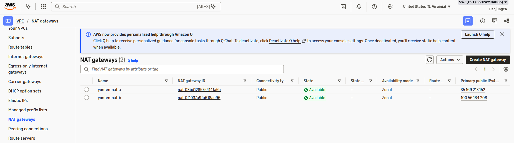

### A problem I fixed during teardown

A push without `[skip ci]` started a new deploy, and that run was stopped part-way. It left two problems behind:

- a **lock** on the Terraform state, which blocked every later run;
- a **database that Terraform did not know about**, which blocked the deletion of its subnet group, parameter group and security group.

I confirmed the lock was more than a day old, so no run was still using it, and removed it. I deleted the orphaned database by hand, then ran *Tear down* again, which removed everything else.

### Step 4 – I kept the bootstrap until marking

The state bucket and the OIDC role cost nothing, so I kept them until the assignment is marked. Afterwards I will empty the state bucket and run:

```bash
cd infra/bootstrap
terraform destroy -var="github_repo=Rynorbu/DSO303-Assignment-02"
```

**Notes:** the demo turns off deletion protection and lets Terraform empty the buckets, so the destroy is clean – for real production I would turn deletion protection on. The KMS key waits 7 days before it is deleted, at no cost.

---

## 13. Cost

| Item (demo, us-east-1) | About per day |
|---|---:|
| RDS `db.t4g.micro` Multi-AZ | $1.60 |
| 2 NAT gateways (one per AZ) | $2.20 |
| SQS interface endpoint (2 AZs) | $0.50 |
| WAF web ACL and rules | $0.30 |
| Lambda, API Gateway, S3, SQS, SES and CloudFront at demo volume | about $0 (free tier) |
| **Total** | **$4 to $5** |
