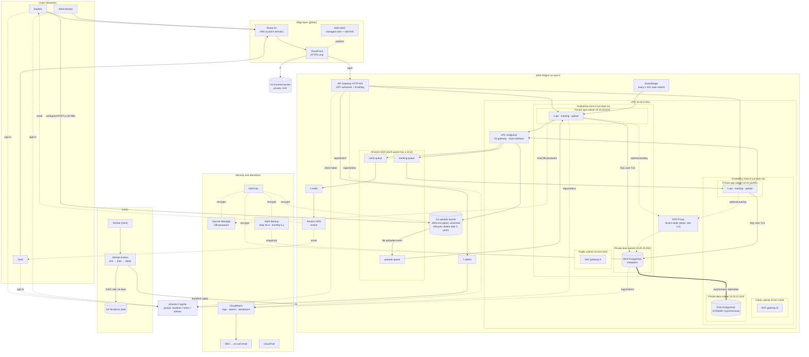
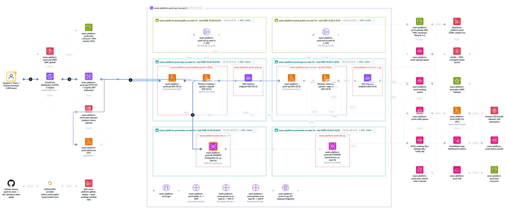
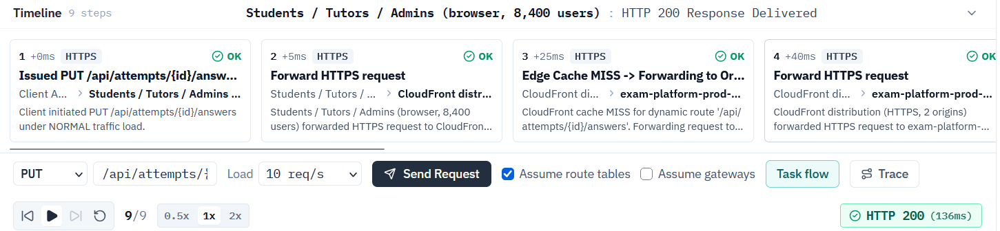

# Architecture – Online Exam & Assignment Platform

**What it is:** a serverless platform on AWS where 8,000 students sit timed exams and upload assignments, and 400 staff create exams, mark them and release results.

**Key idea:** every part runs in **two Availability Zones (AZs)**, the database is **private**, slow work goes through **queues**, and large files go **straight to S3**. Everything is built by Terraform ([`../infra`](../infra)) and redeployed by GitHub Actions on every push to `main`.

---

## 1. Architecture diagram

### 1.1 Production architecture

### 1.2 The same architecture built in the Cloud Architecture Lab

The lab files are in [`lab/`](lab). Each one can be imported (**Export → Upload JSON**) and simulated. All four have been tested:

| File | What it simulates | Result |
|---|---|---|
| [`0-overall-architecture.json`](lab/0-overall-architecture.json) | The full architecture | HTTP 200 |
| [`1-walkthrough-exam-autosave.json`](lab/1-walkthrough-exam-autosave.json) | Walkthrough 1: autosave reaches the database | HTTP 200 |
| [`2-walkthrough-upload-notify.json`](lab/2-walkthrough-upload-notify.json) | Walkthrough 2: file goes to S3 → SQS → Lambda | HTTP 202 |
| [`3-az-failure.json`](lab/3-az-failure.json) | AZ us-east-1a fails | HTTP 200 (served from AZ B) |

> The lab app always divides the VPC into equal subnets, so it shows `/19` sizes. The real `/24` subnet ranges are written in each subnet's name.

### 1.3 What was deployed (AWS Free plan)

The live demo runs on an **AWS Free plan** account. Two settings differ from the production design; nothing else changes.

| Item | Production (exam week) | Deployed demo | Why it still meets the targets |
|---|---|---|---|
| RDS Proxy | On, for connection pooling | Off (Free plan does not allow it) | Each Lambda keeps **1** database connection over verified TLS; demo traffic needs only a few connections |
| Backup retention | 7 days | 1 day (Free plan maximum) | Point-in-time restore still gives about 5 minutes RPO. 5-year records come from AWS Backup and S3 lifecycle |
| Custom domain (Route 53 + ACM) | `exams.uni.ac.uk` | CloudFront domain `dxxxx.cloudfront.net` | Same HTTPS path, just no custom name |
| Multi-AZ database | On | **On** | Survives the loss of one AZ |

### 1.4 Tiers at a glance

| Tier | Services | Where it runs |
|---|---|---|
| Edge | Route 53, CloudFront, WAF | Global |
| Frontend | S3 bucket (private, only CloudFront can read it) | Regional, multi-AZ |
| Sign-in | Cognito user pool with 3 groups | Regional, multi-AZ |
| API and compute | API Gateway HTTP API, Lambda (Node.js 22) | Lambdas in **private app subnets in both AZs** |
| Database | RDS PostgreSQL **Multi-AZ** (primary in AZ A, standby in AZ B) | **Private data subnets**, no public IP |
| Files | S3 uploads bucket with lifecycle rules | Regional (3+ AZs) |
| Background work | SQS queues + dead-letter queues, EventBridge, SES | Regional, multi-AZ |
| Network | VPC, 6 subnets, internet gateway, 1 NAT per AZ, S3 and SQS endpoints, security groups | 2 AZs |
| Security and ops | KMS, Secrets Manager, IAM, CloudWatch, SNS, CloudTrail, AWS Backup | Regional |
| CI/CD | GitHub Actions + OIDC + Terraform (state in S3) | — |

---

## 2. Request walkthroughs

### Walkthrough 1 – A student opens an exam and answers autosave

| Step | What happens | Services |
|---|---|---|
| 1 | The student opens the exam site. The page files come from the CloudFront cache (or from the private S3 bucket on a miss). WAF checks every request. | CloudFront, WAF, S3 |
| 2 | The student signs in. Cognito returns a token that says the user is in the **students** group. | Cognito |
| 3 | The student clicks **Start exam**. The browser sends `POST /api/exams/{id}/start` with the token. CloudFront passes `/api/*` to API Gateway, which **checks the token before any code runs**. | CloudFront, API Gateway |
| 4 | API Gateway calls the **api Lambda**. It runs in the private app subnets of both AZs. | Lambda, VPC |
| 5 | The Lambda reads the database password from Secrets Manager (cached for 5 minutes) and connects to **RDS over TLS**. It creates the attempt with a **deadline stored on the server**, so refreshing the page cannot reset the timer. | Secrets Manager, RDS |
| 6 | The browser receives the questions **without the correct answers**, and starts the timer. Every answer is also copied to the browser's local storage. | Browser |
| 7 | **Every 30 seconds** the browser sends `PUT /api/attempts/{id}/answers` (same path as step 3–5). RDS writes it and **copies it to the standby in AZ B before confirming**. The screen shows "Saved 10:41:30". | API Gateway, Lambda, RDS Multi-AZ |
| 8 | If a save fails, the screen shows "Offline – kept on this device" and tries again on the next tick. No answers are lost. | Browser |
| 9 | When the student clicks **Submit**, the Lambda puts a message on the **SQS marking queue**. The marking Lambda marks the MCQs automatically. If the student just closes the tab, **EventBridge** submits the attempt when time runs out. | SQS, Lambda, EventBridge |

**Simulated in the Cloud Architecture Lab – HTTP 200 in 138 ms, all 11 steps OK:**

| Steps 1–4 | Steps 5–8 | Steps 8–11 |
|---|---|---|
|  |  |  |

### Walkthrough 2 – A student uploads a 40 MB assignment and the tutor is notified

| Step | What happens | Services |
|---|---|---|
| 1 | The student picks `report.pdf` (40 MB). The browser asks for an upload link: `POST /api/assignments/{id}/upload-url`. | CloudFront, WAF, API Gateway |
| 2 | The api Lambda checks the file type (PDF or ZIP) and returns an **S3 presigned POST** valid for 15 minutes. It only allows files up to **50 MB**, so S3 itself rejects anything bigger. | Lambda, S3 |
| 3 | The browser uploads the file **directly to S3** with a progress bar. The file never passes through API Gateway (10 MB limit) or Lambda (6 MB limit). S3 encrypts it with the **KMS key**. | S3, KMS |
| 4 | S3 sends a "file uploaded" event to the **SQS uploads queue**. | S3, SQS |
| 5 | The **upload Lambda** reads the event, checks the file through the S3 gateway endpoint, and saves the submission (on time or late) in RDS. | Lambda, VPC endpoint, RDS |
| 6 | The upload Lambda puts an email job on the **SQS notify queue** through the SQS interface endpoint (no internet needed). | SQS |
| 7 | The **notify Lambda** sends the tutor an email through **SES**: "New submission: Assignment 1 – report.pdf (40 MB)". | Lambda, SES |
| 8 | If any step fails, SQS retries it up to 5 times, then moves the message to a **dead-letter queue** and a CloudWatch alarm emails the team. | SQS DLQ, CloudWatch, SNS |
| 9 | The tutor clicks **Download** and gets a presigned link valid for 10 minutes. After 30 days the file moves to cheaper storage, and it is **deleted after 5 years**. | S3 lifecycle |

**Simulated in the Cloud Architecture Lab – HTTP 202 Accepted, all 8 steps OK:**

| Steps 1–4 | Steps 5–8 |
|---|---|
|  |  |

---

## 3. How the design handles the exam peak and the loss of one AZ (≤ 300 words)

**Exam peak (3,000 students start within 5 minutes).** This is about 10 exam starts per second plus about 100 autosaves per second (3,000 students saving every 30 seconds). CloudFront serves the website from edge caches, so only API calls reach AWS in the region. API Gateway and Lambda scale automatically: at about 100 ms per request the peak needs only about 20 Lambdas running at once, far below the default limit of 1,000. API throttling (burst 5,000) protects the backend from spikes. Each Lambda holds one database connection, and for exam week the database is raised to `db.m6g.large` with RDS Proxy switched on to pool connections. Slow work (marking, emails, upload processing) waits in SQS queues with capped consumers, so it never competes with students who are still writing. Files go straight to S3, which scales without limits. CloudWatch alarms warn the team about errors, slow responses or high database CPU.

**Loss of one AZ.** Every tier runs in two AZs. Lambdas have network interfaces in private subnets in both AZs, so new requests simply run in the healthy AZ. API Gateway, Cognito, S3, SQS, SES and CloudFront are regional or global services that keep working without any action. The database is **RDS Multi-AZ**: every write is copied synchronously to a standby in the other AZ, and if the primary fails, AWS promotes the standby in about 1–2 minutes, so confirmed answers are not lost (RPO ≈ 0). During the switch the browser keeps answers locally and retries, and the exam deadline is stored on the server, so students lose neither work nor time. Each AZ has its own NAT gateway. For a corrupted database, point-in-time restore (about 5-minute RPO) and AWS Backup recover within the 1-hour RTO.

### Simulated loss of us-east-1a

Everything in us-east-1a is marked failed (red dots). The autosave is served by the api Lambda in AZ B and the timeline shows **Multi-AZ Automated Database Failover** – still **HTTP 200**.

| Steps 1–4 | Steps 5–8 |
|---|---|
|  |  |

> **Tested for real:** a forced RDS failover moved the primary database to the other AZ while the app kept saving answers (see [`../evidence/aws-app`](../evidence/aws-app)).
