# Architecture – Online Exam & Assignment Platform

This folder contains **Task 1 – Architecture design**:

1. [The full production architecture](#1-the-full-production-architecture)
2. [The architecture tier by tier](#2-the-architecture-tier-by-tier)
3. [Walkthrough 1 – A student opens an exam and answers autosave](#3-walkthrough-1--a-student-opens-an-exam-and-answers-autosave)
4. [Walkthrough 2 – A student uploads a 40 MB assignment and the tutor is notified](#4-walkthrough-2--a-student-uploads-a-40-mb-assignment-and-the-tutor-is-notified)
5. [How the design handles the exam peak and the loss of one AZ](#5-how-the-design-handles-the-exam-peak-and-the-loss-of-one-az--300-words)
   - [Exam peak](#51-exam-peak--3000-students-start-within-5-minutes) · [Loss of one AZ](#52-loss-of-one-availability-zone) · [Simulated loss of us-east-1a](#53-simulated-loss-of-us-east-1a)
6. [Production design vs. deployed demo](#6-production-design-vs-deployed-demo)
7. [Cloud Architecture Lab files](#7-cloud-architecture-lab-files)
---

## 1. The full production architecture

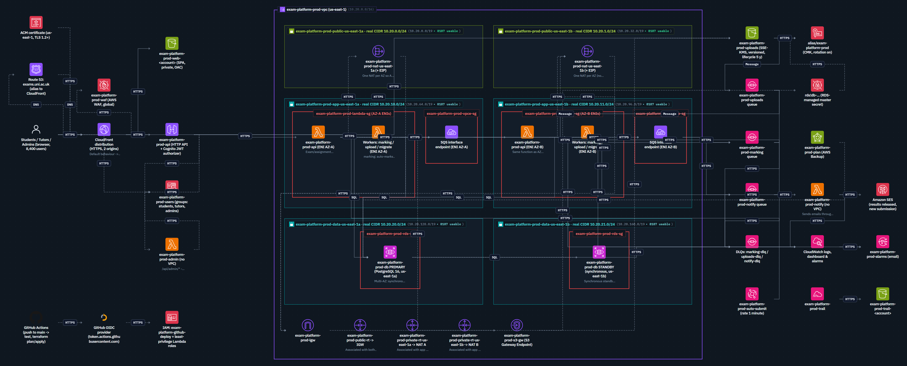

**In one sentence:** a **serverless** platform in `us-east-1` where every tier runs across **two Availability Zones** (us-east-1a and us-east-1b), the database is **private and Multi-AZ**, slow work goes through **queues**, and large files go **straight to S3**.

**How to read the diagram:**

- **Left** – the users and the **edge layer**: Route 53 (DNS), ACM (certificate), CloudFront, WAF, the S3 website bucket, API Gateway, Cognito and the admin Lambda.
- **Middle** – the **VPC** (`10.20.0.0/16`). The two columns are the two AZs, and each AZ has three rows of subnets:
  - **public** subnet – NAT gateway
  - **private app** subnet – Lambda functions and the SQS endpoint
  - **private data** subnet – the RDS database (primary in 1a, standby in 1b)
- **Bottom of the VPC** – the internet gateway, the route tables and the S3 gateway endpoint.
- **Right** – the regional services: S3 uploads, SQS queues and DLQs, the notify Lambda, SES, KMS, Secrets Manager, Backup, CloudWatch, SNS, EventBridge and CloudTrail.
- **Bottom left** – the **CI/CD pipeline**: GitHub Actions - OIDC - IAM.

| Requirement | Where it is in the design |
|---|---|
| VPC with public and private subnets in 2 AZs | 6 subnets: public, private app and private data in **each** AZ |
| Edge layer (DNS, CDN, WAF) | Route 53 - CloudFront + WAF |
| Frontend | S3 website bucket, readable only by CloudFront |
| API and compute | API Gateway HTTP API - Lambda in both AZs |
| Authentication | Cognito user pool with `students`, `tutors`, `admins` groups |
| Database | RDS PostgreSQL **Multi-AZ** in private data subnets |
| File storage with lifecycle rules | S3 uploads bucket: IA after 30 d - Glacier IR 180 d - Deep Archive 365 d - delete after 5 years |
| Async processing for marking and emails | SQS marking / uploads / notify queues + DLQs - Lambda - SES; EventBridge auto-submit |
| Monitoring | CloudWatch logs, alarms and dashboard - SNS email; CloudTrail audit |
| Secrets | Secrets Manager (DB password), KMS key for encryption |
| CI/CD pipeline | GitHub Actions - OIDC role - Terraform |

---

## 2. The architecture tier by tier

### 2.1 Edge layer and sign-in

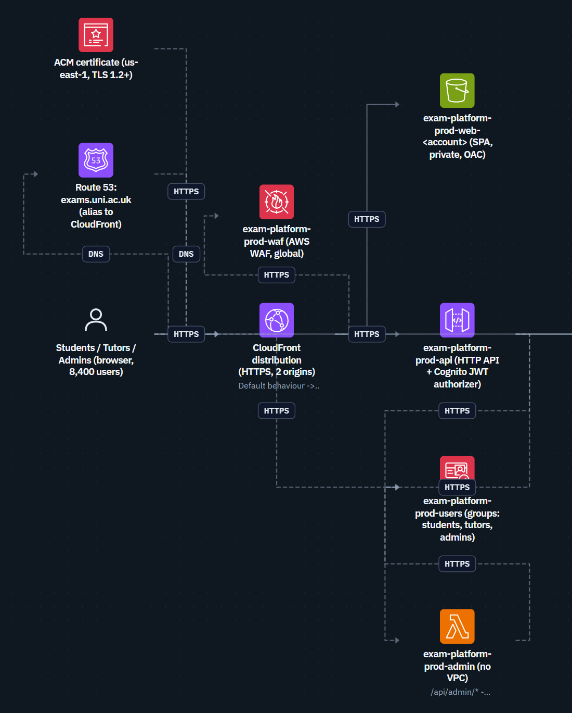

| Component | What it does |
|---|---|
| **Route 53** | DNS for `exams.uni.ac.uk` – an alias record points the domain to CloudFront |
| **ACM** | Free TLS certificate for the custom domain, issued in us-east-1 for CloudFront (TLS 1.2 or higher) |
| **CloudFront** | One HTTPS entry point: `/*` - S3 website, `/api/*` - API Gateway. Caches the website at the edge |
| **AWS WAF** | Blocks common attacks and request floods before they reach the API (managed rules + rate limit per IP) |
| **S3 website bucket** | Holds the single-page app; private, only CloudFront can read it (Origin Access Control) |
| **API Gateway (HTTP API)** | `/api/*` routes; **checks the Cognito token before any code runs**; throttling |
| **Cognito** | Sign-in with three groups: `students`, `tutors`, `admins` |
| **admin Lambda** | Creates users and assigns groups (`/api/admin/*`); runs outside the VPC |

### 2.2 Network – two Availability Zones

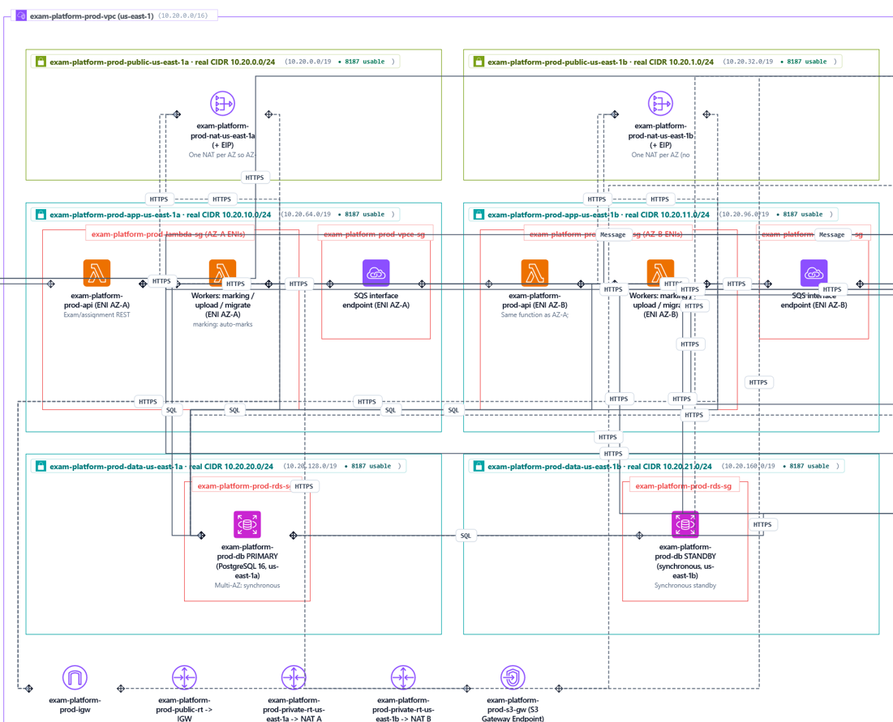

| Subnet | us-east-1a | us-east-1b | What runs there |
|---|---|---|---|
| **Public** | `10.20.0.0/24` | `10.20.1.0/24` | NAT gateway (one per AZ) |
| **Private app** | `10.20.10.0/24` | `10.20.11.0/24` | api + worker Lambdas, SQS interface endpoint |
| **Private data** | `10.20.20.0/24` | `10.20.21.0/24` | RDS **primary** (1a) and **standby** (1b) |

**Security groups – nothing is open to the internet:**

| Security group | Allows in | Used by |
|---|---|---|
| `lambda-sg` | nothing (outbound only) | VPC Lambdas |
| `rds-sg` | PostgreSQL 5432 **only from `lambda-sg`** | RDS |
| `vpce-sg` | HTTPS 443 only from `lambda-sg` | SQS interface endpoint |

> The lab app always splits the VPC into equal `/19` blocks, so the real `/24` ranges are written in each subnet's name.

### 2.3 Routing

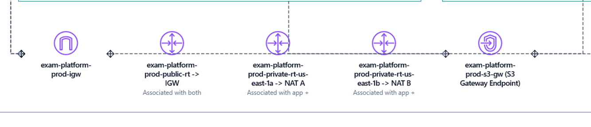

- **Public route table** → internet gateway (both public subnets).
- **Private route table for us-east-1a** → NAT gateway A; **for us-east-1b** → NAT gateway B. Each AZ has its own exit to the internet, so losing one AZ never cuts the other off.
- **S3 gateway endpoint** on both private route tables – Lambdas reach S3 privately and for free.

### 2.4 Storage, async processing, security and operations

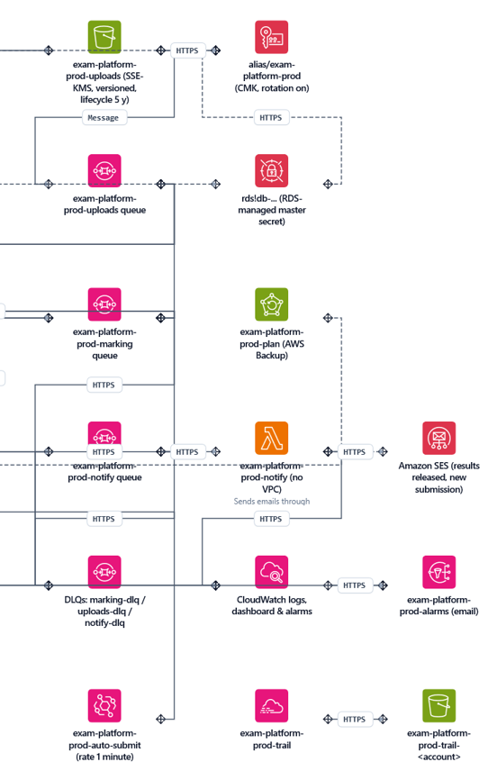

| Group | Components |
|---|---|
| **File storage** | S3 uploads bucket – KMS-encrypted, versioned, **lifecycle rules for 5 years** |
| **Queues** | SQS **uploads**, **marking** and **notify** queues, each with a **dead-letter queue** (after 5 failed tries) |
| **Email** | notify Lambda → **Amazon SES** ("results released", "new submission") |
| **Scheduler** | **EventBridge** every minute → auto-submit attempts whose time is up |
| **Security** | **KMS** key (RDS, S3, secrets, backups), **Secrets Manager** (DB password), **IAM** least-privilege roles |
| **Operations** | **CloudWatch** logs, alarms and dashboard → **SNS** email to the team; **CloudTrail** audit log; **AWS Backup** (daily 35 days, monthly 5 years) |

---

## 3. Walkthrough 1 – A student opens an exam and answers autosave

| Step | What happens | Services |
|---|---|---|
| 1 | The student opens the exam site. The page comes from the **CloudFront** cache (or the private **S3** bucket on a miss). **WAF** checks every request. | CloudFront, WAF, S3 |
| 2 | The student signs in. **Cognito** returns a token saying the user is in the `students` group. | Cognito |
| 3 | The student clicks **Start exam**: `POST /api/exams/{id}/start` with the token. CloudFront sends `/api/*` to **API Gateway**, which **checks the token before any code runs**. | CloudFront, API Gateway |
| 4 | API Gateway calls the **api Lambda** in a private app subnet (AZ A or AZ B). | Lambda, VPC |
| 5 | The Lambda reads the DB password from **Secrets Manager** and connects to **RDS over TLS** (port 5432 – only allowed from `lambda-sg`). It creates the attempt with a **deadline stored on the server**, so refreshing cannot reset the timer. | Secrets Manager, RDS |
| 6 | The browser gets the questions **without the correct answers** and starts the timer. Answers are also copied to the browser's local storage. | Browser |
| 7 | **Every 30 seconds** the browser sends `PUT /api/attempts/{id}/answers` along the same path. RDS saves it and **copies it to the standby in AZ B before confirming**. The screen shows *"Saved 10:41:30"*. | API Gateway, Lambda, RDS Multi-AZ |
| 8 | If a save fails, the screen shows *"Offline – kept on this device"* and retries on the next tick. No answers are lost. | Browser |
| 9 | On **Submit**, the Lambda puts a message on the **SQS marking queue** and the marking Lambda marks the MCQs. If the student just leaves, **EventBridge** submits the attempt when time runs out. | SQS, Lambda, EventBridge |

### Simulated in the Cloud Architecture Lab

The request path highlighted in blue: student → CloudFront → API Gateway → api Lambda (AZ A) → RDS primary.

**Timeline – steps 1 to 4:** the request leaves the browser, passes CloudFront (cache miss for `/api/*`) and reaches API Gateway.

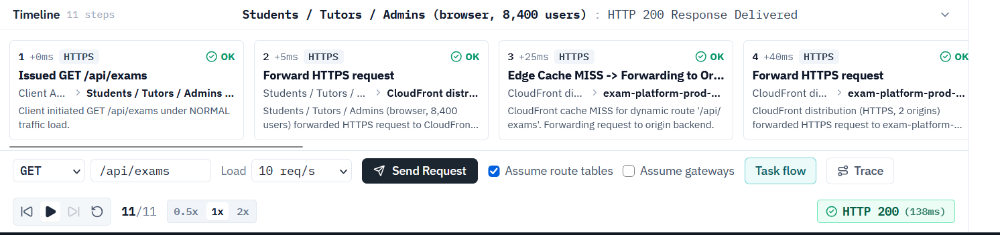

**Timeline – steps 5 to 8:** `lambda-sg` allows the call, API Gateway routes to the api Lambda, and `rds-sg` allows the SQL connection.

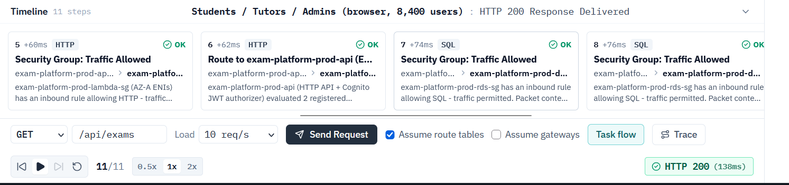

**Timeline – steps 8 to 11:** the Lambda sends the SQL, the RDS primary commits it, and the response goes back.

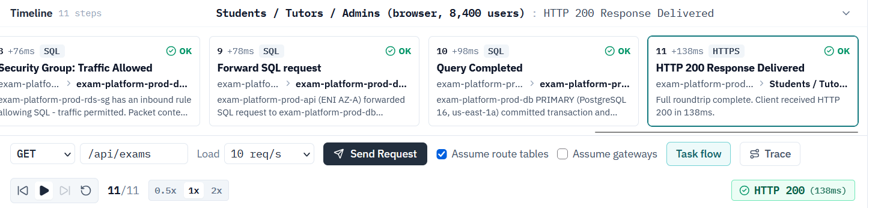

**Result: HTTP 200 in 138 ms – all 11 steps OK.**

---

## 4. Walkthrough 2 – A student uploads a 40 MB assignment and the tutor is notified

| Step | What happens | Services |
|---|---|---|
| 1 | The student picks `report.pdf` (40 MB). The browser asks for an upload link: `POST /api/assignments/{id}/upload-url`. | CloudFront, WAF, API Gateway |
| 2 | The api Lambda checks the file type (PDF or ZIP) and returns an **S3 presigned POST**, valid for 15 minutes and limited to **50 MB** – S3 itself rejects anything bigger. | Lambda, S3 |
| 3 | The browser uploads the file **directly to S3**. It never passes through API Gateway (10 MB limit) or Lambda (6 MB limit). S3 encrypts it with the **KMS key**. | S3, KMS |
| 4 | S3 sends a "file uploaded" event to the **SQS uploads queue**. | S3, SQS |
| 5 | The **upload Lambda** reads the message, checks the file through the **S3 gateway endpoint**, and saves the submission (on time or late) in **RDS**. | Lambda, VPC endpoint, RDS |
| 6 | The upload Lambda puts an email job on the **SQS notify queue** through the **SQS interface endpoint**. | SQS |
| 7 | The **notify Lambda** emails the tutor through **SES**: *"New submission: Assignment 1 – report.pdf (40 MB)"*. | Lambda, SES |
| 8 | If any step fails, SQS retries up to 5 times, then moves the message to a **dead-letter queue**; a CloudWatch alarm emails the team. | SQS DLQ, CloudWatch, SNS |
| 9 | The tutor clicks **Download** and gets a link valid for 10 minutes. **Lifecycle rules** move the file to cheaper storage and delete it after 5 years. | S3 lifecycle |

### Simulated in the Cloud Architecture Lab

The request path highlighted in blue: browser → S3 uploads bucket → SQS uploads queue → worker Lambdas in both AZs.

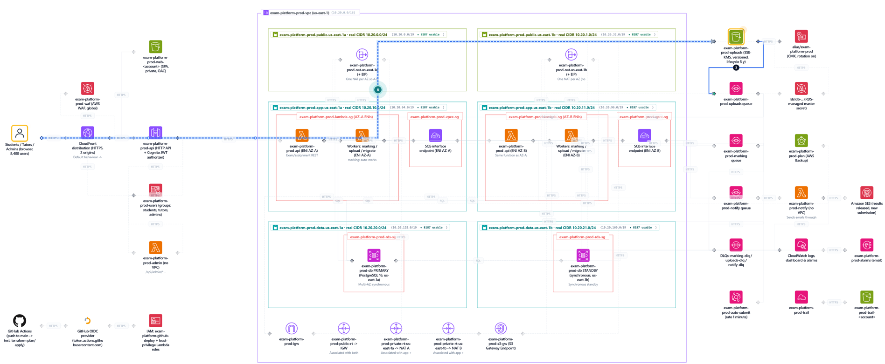

**Timeline – steps 1 to 4:** the file goes straight to S3, S3 sends the message to SQS, and the Lambda event source mapping picks it up.

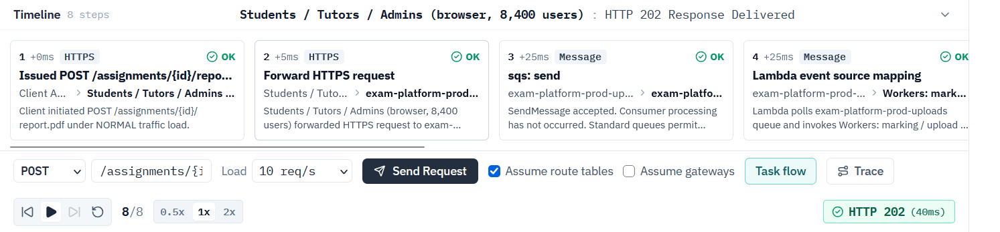

**Timeline – steps 5 to 8:** the worker Lambdas in **AZ A and AZ B** receive the message and the upload is accepted.

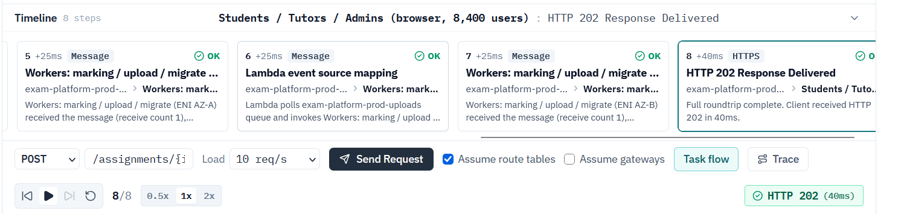

**Result: HTTP 202 Accepted – all 8 steps OK.** The next hop on the diagram is notify queue → notify Lambda → SES email to the tutor.

---

## 5. How the design handles the exam peak and the loss of one AZ (≤ 300 words)

### 5.1 Exam peak – 3,000 students start within 5 minutes

This means about **10 exam starts per second** plus **100 autosaves per second** (3,000 students saving every 30 seconds).

- **Edge caching:** CloudFront serves the website from edge caches, so only API calls reach the region.
- **Automatic scaling:** API Gateway and Lambda scale automatically. At about 100 ms per request the peak needs only about **20 concurrent Lambdas**, far below the default limit of 1,000.
- **Throttling:** API throttling (burst 5,000) protects the backend from spikes.
- **Database connections:** each Lambda holds one connection; for exam week the database is raised to `db.m6g.large` with **RDS Proxy** pooling connections.
- **Queues:** marking, emails and upload processing wait in **SQS** queues with capped consumers, so they never compete with students still writing.
- **Uploads:** files go straight to **S3**, which scales without limits.
- **Monitoring:** CloudWatch alarms warn the team about errors, slow responses or high database CPU.

### 5.2 Loss of one Availability Zone

Every tier runs in **two AZs**.

- **Compute:** Lambdas have network interfaces in private subnets in both AZs, so new requests run in the healthy AZ.
- **Managed services:** API Gateway, Cognito, S3, SQS, SES and CloudFront are regional or global and keep working without action.
- **Database:** RDS **Multi-AZ** copies every write synchronously to a standby in the other AZ. If the primary fails, AWS promotes the standby in about **1–2 minutes**, so confirmed answers are not lost (**RPO ≈ 0**).
- **Students:** during the switch the browser keeps answers locally and retries, and the deadline is stored on the server, so students lose neither work nor time.
- **Network:** each AZ has its own NAT gateway.
- **Corruption:** point-in-time restore (about **5-minute RPO**) and AWS Backup recover a damaged database within the **1-hour RTO**.

*(283 words)*

### 5.3 Simulated loss of us-east-1a

In the Cloud Architecture Lab, everything in **us-east-1a** was marked as failed (red dots): the api Lambda, the worker Lambda, the NAT gateway, the SQS endpoint and the **RDS primary**. Then an autosave was sent.

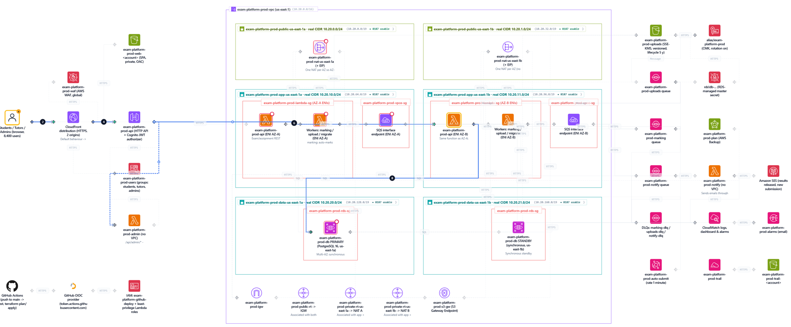

**Steps 1–4** – the autosave `PUT /api/attempts/{id}/answers` enters through CloudFront and API Gateway as normal:

**Steps 5–8** – API Gateway sends the request to the **api Lambda in AZ B**, and the timeline shows **"Multi-AZ Automated Database Failover"** – the standby in us-east-1b becomes the primary:

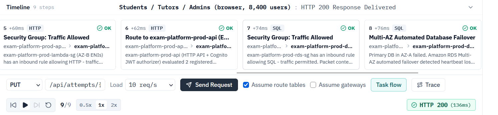

**Result: HTTP 200** – the autosave is served by the api Lambda in AZ B after the database failover, so answers are still saved while one AZ is down.

> **Also tested for real on AWS:** a forced RDS failover moved the primary database to the other AZ while the app kept working. See [`evidence/README.md` › Two-AZ database](../evidence/README.md#23-two-az-database--a-real-forced-failover).

---

## 6. Production design vs. deployed demo

The demo ran on an **AWS Free plan** account, so a few settings were reduced. The architecture is the same.

| Item | Production (exam week) | Deployed demo | Why the targets are still met |
|---|---|---|---|
| RDS Proxy | On, to pool connections | Off (not allowed on the Free plan) | Each Lambda keeps 1 connection over TLS; demo traffic is small |
| Database size | `db.m6g.large` | `db.t4g.micro` | Same engine and Multi-AZ setup, smaller machine |
| Backup retention | 7 days | 1 day | Point-in-time restore still gives about 5 minutes RPO |
| Custom domain | Route 53 + ACM `exams.uni.ac.uk` | CloudFront domain | Same HTTPS path, no custom name |
| Multi-AZ database | On | **On** | Survives the loss of one AZ |

---

## 7. Cloud Architecture Lab files

Every diagram above can be opened in the Cloud Architecture Lab: **Open the lab → Export → Upload JSON**, then press **Send Request**.

| File | What it shows | Result |
|---|---|---|
| [`lab/0-overall-architecture.json`](lab/0-overall-architecture.json) | The full architecture | HTTP 200 |
| [`lab/1-walkthrough-exam-autosave.json`](lab/1-walkthrough-exam-autosave.json) | Walkthrough 1 – exam + autosave | HTTP 200 |
| [`lab/2-walkthrough-upload-notify.json`](lab/2-walkthrough-upload-notify.json) | Walkthrough 2 – upload + notify | HTTP 202 |
| [`lab/3-az-failure.json`](lab/3-az-failure.json) | Loss of us-east-1a | HTTP 200 (served from AZ B) |

Every service is explained in [`../docs/services.md`](../docs/services.md).
