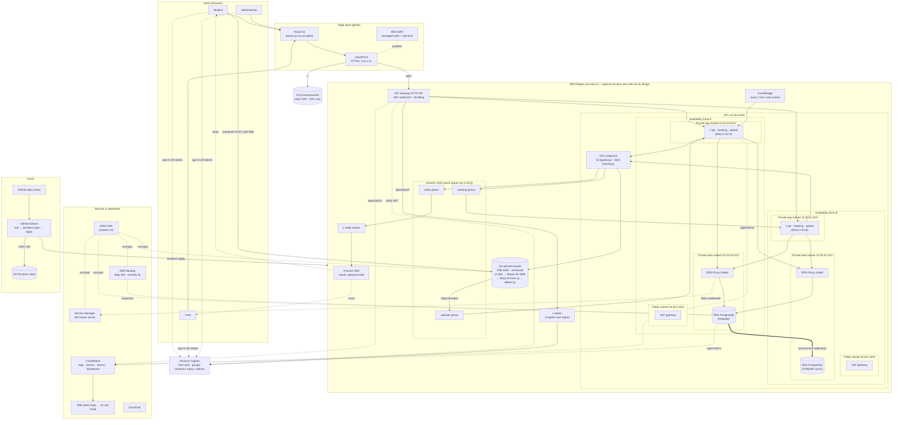

# Architecture – Online Exam & Assignment Platform

Serverless, two-Availability-Zone design on AWS for 8,000 students and 400 staff.
Everything in this diagram is created by the Terraform code in [`../infra`](../infra).

## 1. Production architecture

> To export a PNG for the report: paste the block into <https://mermaid.live> → *Actions* → *PNG*, and save it as `architecture/architecture.png`.

### Tiers at a glance

| Tier | Components | Placement |
|---|---|---|
| Edge | Route 53, CloudFront, AWS WAF, ACM | Global (WAF/ACM in us-east-1) |
| Presentation | S3 static frontend (private, Origin Access Control) | Regional, multi-AZ |
| Identity | Cognito user pool + groups, JWT authorizer | Regional, multi-AZ |
| API / compute | API Gateway HTTP API, Lambda (Node.js 22, arm64) | Lambda ENIs in **both** private app subnets |
| Data | RDS PostgreSQL **Multi-AZ** + RDS Proxy | **Private** data subnets in AZ A and AZ B, no public IP |
| Files | S3 uploads bucket with lifecycle rules | Regional (≥3 AZs) |
| Async | SQS marking / uploads / notify queues + DLQs, EventBridge, SES | Regional, multi-AZ |
| Ops & security | CloudWatch, SNS, CloudTrail, KMS, Secrets Manager, AWS Backup | Regional |
| Delivery | GitHub Actions + OIDC + Terraform (S3 remote state) | — |

## 2. Request walkthroughs

### Walkthrough 1 – A student opens an exam and answers autosave

1. **DNS and edge.** The browser resolves `exams.uni.ac.uk` with **Route 53**, which returns the **CloudFront** alias. The SPA files come from the CloudFront edge cache. On a cache miss CloudFront fetches them from the private **S3 frontend bucket** through Origin Access Control. **WAF** inspects every request.
2. **Sign-in.** The student signs in with **Cognito**. The ID token they receive contains `cognito:groups = ["students"]`.
3. **Open the exam.** The browser calls `POST /api/exams/{id}/start` with the token. CloudFront forwards `/api/*` to **API Gateway**, whose **JWT authorizer** validates the token's signature, expiry and audience before any code runs.
4. **Lambda.** API Gateway invokes the **api Lambda**, which runs in the private app subnets of both AZs. The function generates an IAM auth token and connects through **RDS Proxy** to **RDS PostgreSQL** over TLS. No password is stored in the function.
5. **Create or resume the attempt.** The Lambda checks the exam window and runs an `INSERT … ON CONFLICT` to create the attempt. The insert is idempotent, so a refresh resumes the same attempt. The attempt gets a **server-side deadline**. The response contains the questions **with the correct answers stripped out**, plus the deadline and the student's saved answers.
6. **Answering.** Every keystroke is copied to the browser's `localStorage`, so the local copy is always current and nothing is lost if the network drops.
7. **Autosave.** Every **30 seconds** the browser sends `PUT /api/attempts/{id}/answers`. It takes the same path as in steps 3–4 and updates `answers` and `last_saved_at`, but only while the attempt is `in_progress` and before the deadline plus a 30 s grace period. The database commits the write **synchronously to the standby in the other AZ**. The UI shows "Saved 10:41:30".
8. **Failure handling.** If a save fails, the UI shows "Offline – saved on this device" and retries on the next tick.
9. **Submit.** `POST …/submit` sets the status to `submitted` and puts a message on the **SQS marking queue**. The **marking Lambda** auto-marks the MCQs and flags short answers for the tutor.
10. **Auto-submit.** If the student just closes the tab, an **EventBridge** rule that runs every minute auto-submits the expired attempt.

### Walkthrough 2 – A student uploads a 40 MB assignment and the tutor is notified

1. **Request an upload URL.** The student picks `report.pdf` (40 MB). The browser calls `POST /api/assignments/{id}/upload-url`, and the request passes through CloudFront, WAF, API Gateway and the JWT check.
2. **Presigned POST.** The **api Lambda** checks that the file extension is PDF or ZIP and that the assignment exists. It then returns an S3 **presigned POST** that expires after 15 minutes. The policy pins the object key `assignments/{assignment}/{student}/…`, the `Content-Type`, and **`content-length-range` 1 B – 50 MB**, so S3 itself rejects any file larger than 50 MB.
3. **Upload directly to S3.** The browser uploads the 40 MB file **straight to the S3 uploads bucket** over HTTPS and shows a progress bar. The file never passes through API Gateway (which has a 10 MB limit) or Lambda (6 MB). S3 encrypts the object with **SSE-KMS** and versions it.
4. **Event to the queue.** S3 sends an `ObjectCreated` event to the **SQS uploads queue**.
5. **Record the submission.** The **upload-processor Lambda**, which runs in the VPC, reads the event. It calls `HeadObject` through the **S3 gateway endpoint** to read the student-email metadata, then inserts a row into `submissions` through RDS Proxy. The insert is idempotent because `s3_key` is UNIQUE.
6. **Queue the email.** The same Lambda then puts a message on the **SQS notify queue** through the **SQS interface endpoint**, without using the internet.
7. **Send the email.** The **notify Lambda** sends the tutor an email through **Amazon SES**: "student@uni.ac.uk submitted report.pdf (40.0 MB) for Assignment 1".
8. **Retries and failures.** Any step that fails is retried up to 5 times. After that the message moves to a **dead-letter queue**, and a CloudWatch alarm notifies operations.
9. **Tutor download.** The tutor opens *Assignments → View*. The API returns a **presigned GET** link that is valid for 10 minutes so the tutor can download the file.
10. **Lifecycle.** The object moves to Standard-IA after 30 days, Glacier Instant Retrieval after 180 days, and Deep Archive after 1 year. It is **deleted after 5 years**.

## 3. Handling the exam peak and the loss of one AZ (≤ 300 words)

**Peak (3,000 students start within 5 minutes).** CloudFront serves static content from edge caches. API Gateway and Lambda scale automatically. The peak is roughly 10 exam starts per second plus 100 autosaves per second (3,000 students saving every 30 seconds). At about 100 ms per request that needs only about 20 concurrent Lambda instances, far below the 1,000 default limit. Stage throttling (burst 5,000) absorbs spikes. RDS Proxy pools thousands of short Lambda connections into a few database connections, so PostgreSQL never runs out of connections. Slow work (marking, result emails, upload processing) goes through SQS queues, and capped consumer concurrency keeps it from competing with live exams. Uploads go directly to S3. Before exam week the database class is raised (db.m6g.large), and CloudWatch alarms on p95 latency, throttles and database CPU warn the team early.

**Loss of one AZ.** Every tier runs in two AZs. Lambda ENIs sit in private subnets in both AZs, so invocations simply run in the healthy AZ. API Gateway, Cognito, S3, SQS, SES and CloudFront are regional or global services that tolerate an AZ failure without action. RDS Multi-AZ replicates **synchronously** to a standby in the second AZ. If the primary's AZ fails, RDS promotes the standby within 1–2 minutes, and RDS Proxy redirects connections without any DNS caching delay. Committed answers are never lost (RPO ≈ 0 for an AZ failure). During failover the browser keeps answers in localStorage and retries saves, and the server-side deadline is unchanged, so students lose no time or work. For a corrupted or deleted database, point-in-time recovery (5-minute RPO) and AWS Backup snapshots restore a new instance within the 1-hour RTO. Each AZ has its own NAT gateway and route table, so no AZ depends on the other.
