# Evidence – Implementation report

As agreed with the tutor, **screenshots replace the video**. This page explains what each set of screenshots proves, in the order of the marking rubric.

| Rubric row | Section |
|---|---|
| Implementation – Cloud Architecture Lab | [1](#1-cloud-architecture-lab) |
| Implementation – AWS deployment | [2](#2-aws-deployment-the-app-working-on-aws) |
| Implementation – IaC and CI/CD | [3](#3-infrastructure-as-code-and-cicd) |
| Supporting: local run | [4](#4-local-run-supporting) |

The live stack ran in **us-east-1** on an AWS Free plan account (see [README – AWS Free plan deployment](../README.md#aws-free-plan-deployment)).

---

## 1. Cloud Architecture Lab

**What was done:** the full production architecture was built in the Cloud Architecture Lab (VPC, 6 subnets in 2 AZs, NAT per AZ, route tables, security groups, Lambda, RDS primary + standby, CloudFront, WAF, API Gateway, Cognito, S3, SQS + DLQs, EventBridge, SES, KMS, Secrets Manager, Backup, CloudWatch, SNS, CloudTrail, GitHub OIDC → IAM). Both walkthroughs and one AZ failure were then simulated. The lab files are in [`../architecture/lab`](../architecture/lab).

### 1.1 The build

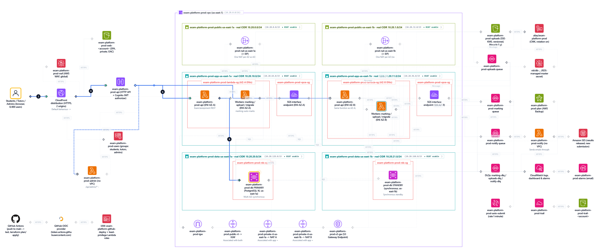

| Screenshot | What it shows |
|---|---|
| [`full-architecture.png`](architecture/full-architecture.png) | The whole design: VPC `10.20.0.0/16`, public / app / data subnets in **us-east-1a and us-east-1b**, every service |
| [`edgee.png`](architecture/edgee.png) | Users → CloudFront (+ WAF) → S3 website and API Gateway, Cognito groups, admin Lambda |
| [`subnets.png`](architecture/subnets.png) | api and worker Lambdas in **lambda-sg** in both AZs, SQS endpoints in **vpce-sg**, RDS **primary (1a)** and **standby (1b)** in **rds-sg** |
| [`routes.png`](architecture/routes.png) | Internet gateway, public route table → IGW, one private route table per AZ → its own NAT, S3 gateway endpoint |
| [`storage-async.png`](architecture/storage-async.png) | Uploads bucket, uploads / marking / notify queues, DLQs, notify Lambda → SES, EventBridge, KMS, secret, Backup, CloudWatch → SNS, CloudTrail |

### 1.2 Simulation 1 – Student opens an exam and answers autosave

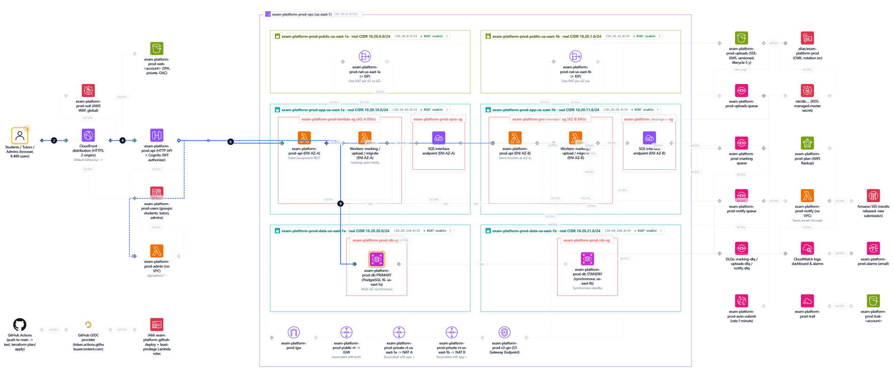

| Steps 1–4 | Steps 5–8 | Steps 8–11 |
|---|---|---|
| 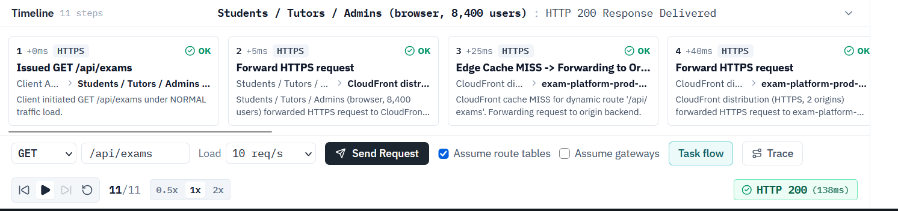 |  | 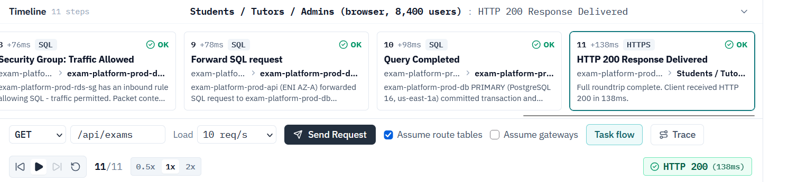 |

Student → CloudFront (cache miss for `/api/*`) → API Gateway → api Lambda in AZ A (**lambda-sg allowed**) → RDS primary on port 5432 (**rds-sg allowed**) → query committed → **HTTP 200 in 138 ms**, all 11 steps OK.

### 1.3 Simulation 2 – Student uploads a 40 MB assignment, tutor notified

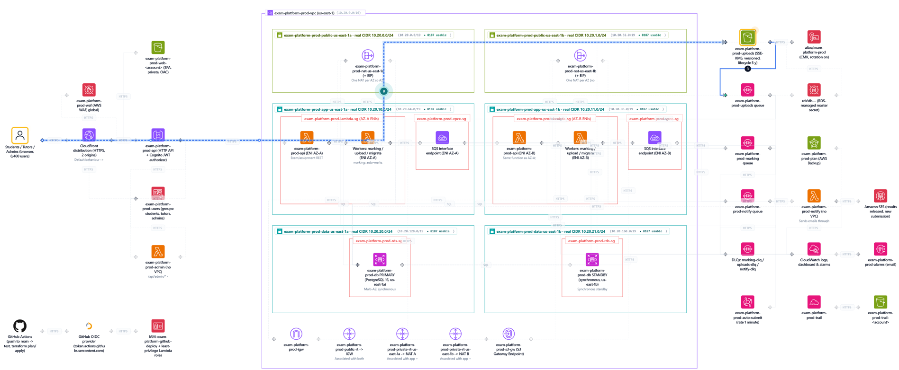

| Steps 1–4 | Steps 5–8 |
|---|---|
|  |  |

The browser uploads straight to the **S3 uploads bucket** → S3 event to the **SQS uploads queue** → Lambda event source mapping → worker Lambdas in **AZ A and AZ B** receive the message → **HTTP 202 Accepted**, all 8 steps OK. The notify queue → notify Lambda → SES email is the next step on the diagram.

### 1.4 Simulation 3 – Loss of Availability Zone us-east-1a

| Steps 1–4 | Steps 5–8 |
|---|---|
| 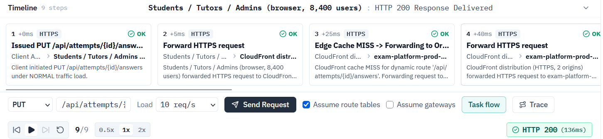 | 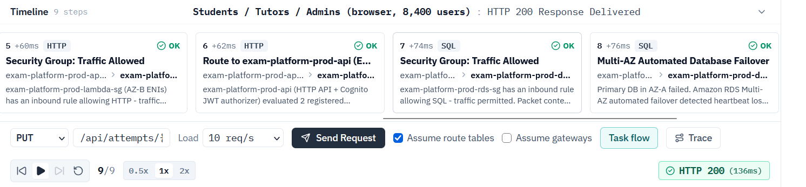 |

The api Lambda, worker Lambda, NAT, SQS endpoint and **database primary in us-east-1a are marked failed** (red dots). The autosave `PUT /api/attempts/{id}/answers` is sent to the **api Lambda in AZ B**, and the timeline shows **"Multi-AZ Automated Database Failover"** – the standby is promoted. The request still returns **HTTP 200**.

---

## 2. AWS deployment: the app working on AWS

The rubric asks for **frontend, API, two-AZ database, S3 uploads and the async step working**. Each one is shown below.

### 2.1 Frontend (CloudFront + S3) and sign-in (Cognito)

| | |
|---|---|
| 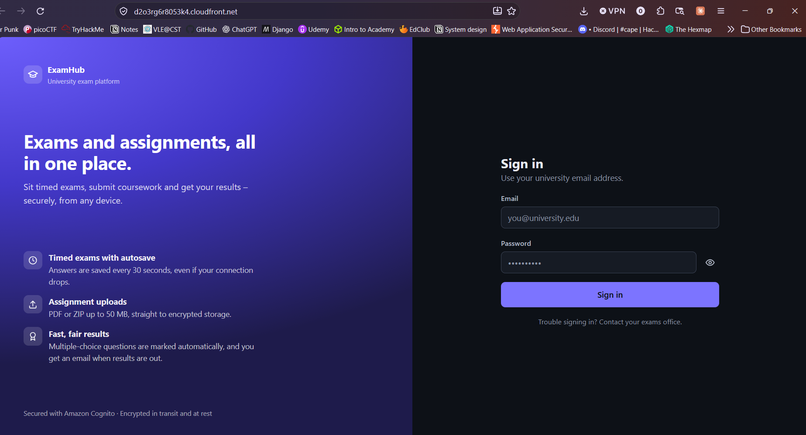 | 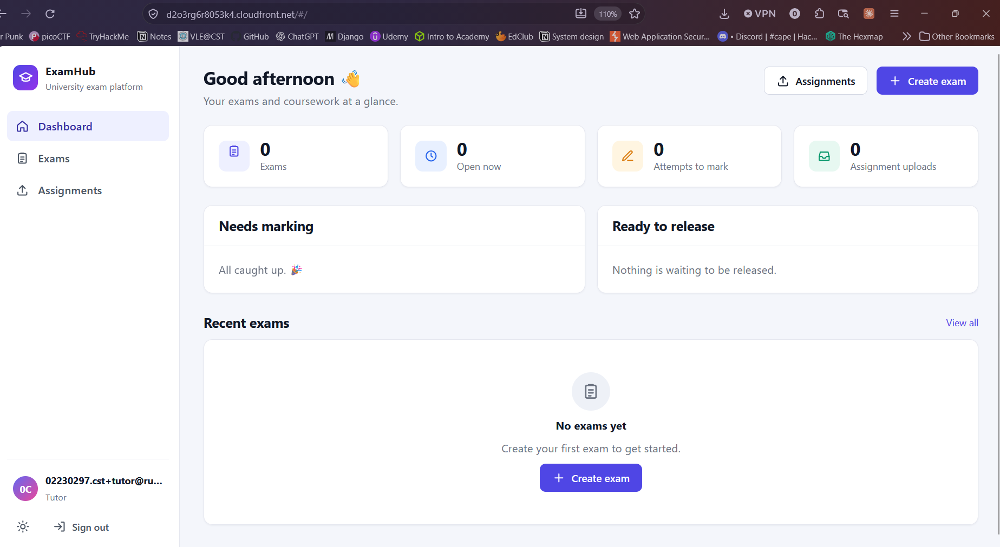 |

The app is served over HTTPS from the CloudFront URL. Users were created in Cognito groups ([`users-created.png`](aws-app/users-created.png), [`cognito-groups.png`](aws-console/cognito-groups.png)). The Lambdas run in private subnets in 2 AZs ([`lamda-vpc.png`](aws-console/lamda-vpc.png)).

### 2.2 API (API Gateway + Lambda) – exam and 30-second autosave

| | |
|---|---|
| 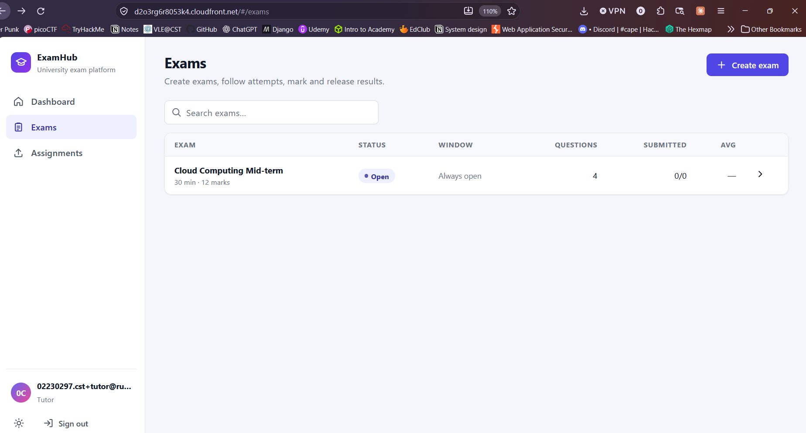 | 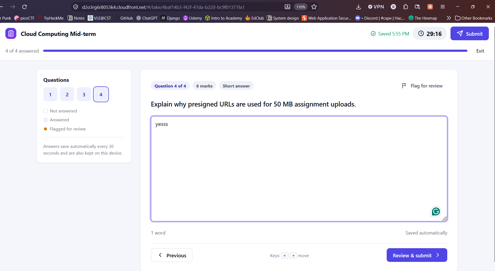 |

The tutor creates an exam, the student starts it ([`student-exam-list.png`](aws-app/student-exam-list.png)) and the screen shows **"Saved hh:mm:ss"** every 30 seconds. `GET /api/health` responds through CloudFront ([`api-health.png`](aws-app/api-health.png)). Routes and the JWT authorizer: [`api-routes.png`](aws-console/api-routes.png), [`api-authorizer.png`](aws-console/api-authorizer.png).

### 2.3 Two-AZ database (RDS Multi-AZ) – and a real failover

| Before failover | After failover |
|---|---|
| 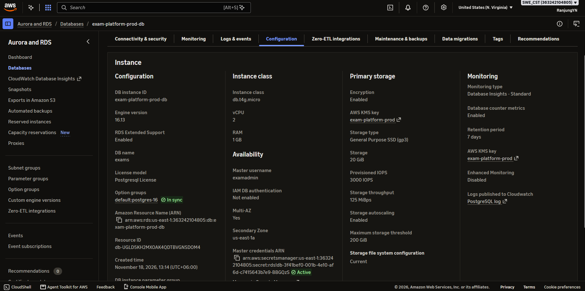 |  |

The database is **Multi-AZ** and **not publicly accessible** ([`databse-configuration.png`](aws-console/databse-configuration.png), [`rds-private.png`](aws-console/rds-private.png)). A forced failover was run with `scripts/az-failover-test.sh` ([during](aws-app/failover-terminal-during.png), [after](aws-app/failover-terminal-after.png)): the primary and standby AZs **swapped**, RDS logged the failover ([`rds-events.png`](aws-app/rds-events.png)), SNS emailed the team ([`mail-on-multiAZs.png`](aws-app/mail-on-multiAZs.png)), and the app kept working.

### 2.4 S3 uploads (40 MB, direct to S3, encrypted)

| | |
|---|---|
| 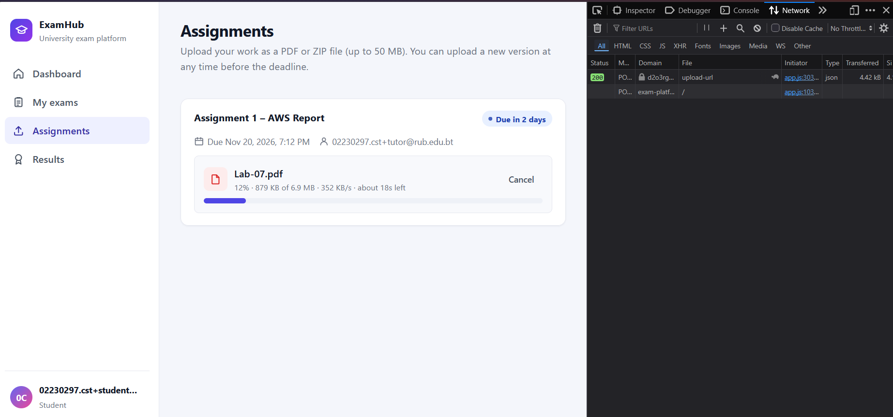 | 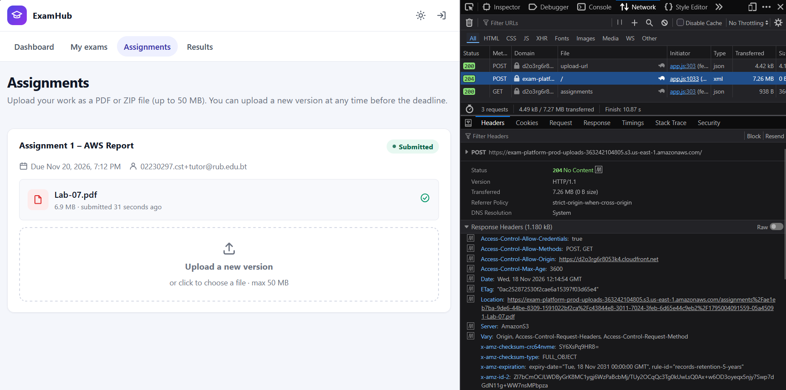 |

The browser's network tab shows the file going to `…s3.amazonaws.com`, not to the API. The stored object is encrypted with **SSE-KMS** ([`s3-object-kms.png`](aws-app/s3-object-kms.png)). Lifecycle rules keep files for 5 years ([`s3-lifecycle.png`](aws-console/s3-lifecycle.png)).

### 2.5 Async step (SQS → Lambda → SES)

| | |
|---|---|
| 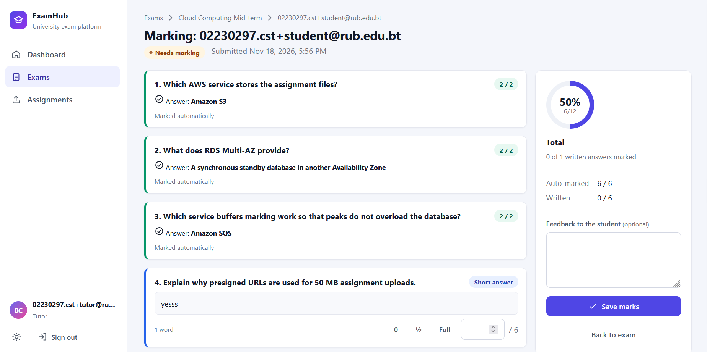 | 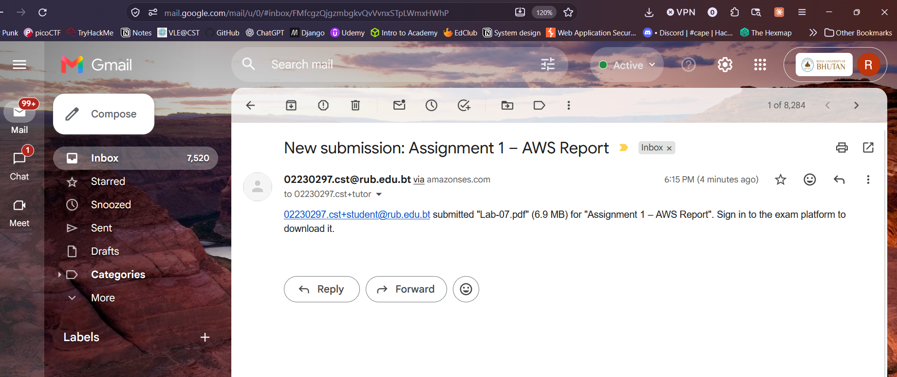 |

- **Marking:** on submit, a message goes to the SQS marking queue and the marking Lambda scores the MCQs ([`marking-log.png`](aws-app/marking-log.png), [`sqs-marking-monitoring.png`](aws-app/sqs-marking-monitoring.png)).
- **Upload → email:** S3 event → uploads queue → upload Lambda → notify queue → notify Lambda → SES email to the tutor ([`upload-lambda-log.png`](aws-app/upload-lambda-log.png), [`notify-lambda-log.png`](aws-app/notify-lambda-log.png)). SES identities are verified ([`ses-verified.png`](aws-console/ses-verified.png)).
- **Results:** the tutor marks the short answers and releases results, which emails the students ([`manual-marking.png`](aws-app/manual-marking.png), [`results-released.png`](aws-app/results-released.png)).

### 2.6 Peak load test

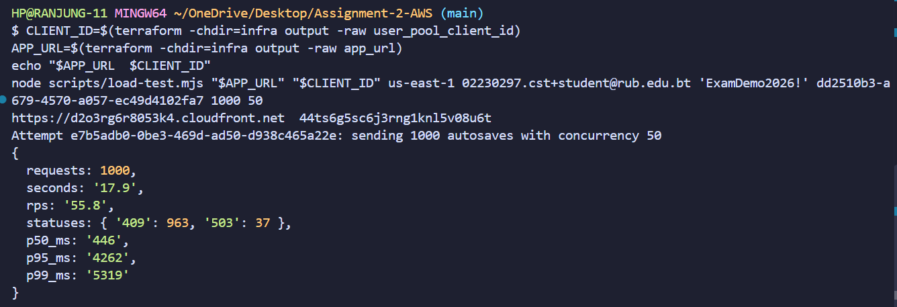

`scripts/load-test.mjs` sent 1,000 autosaves, 50 at a time – the same traffic shape as 3,000 students saving every 30 seconds.

### 2.7 Every component in the AWS Console

[`aws-console/`](aws-console) has one screenshot per component:

| Area | Screenshots |
|---|---|
| Network (2 AZs) | [`vpc`](aws-console/vpc.png), [`subnets-2az`](aws-console/subnets-2az.png), [`subnet-us-east-1b`](aws-console/subnet-us-east-1b.png), [`nat-gateway`](aws-console/nat-gateway.png), [`route-public`](aws-console/route-public.png), [`route-private`](aws-console/route-private.png), [`gateway-endpoint1`](aws-console/gateway-endpoint1.png), [`interface-endpoint`](aws-console/interface-endpoint.png), [`security-groups`](aws-console/security-groups.png), [`rds-sg-inbound`](aws-console/rds-sg-inbound.png) |
| Database | [`database`](aws-console/database.png), [`databse-configuration`](aws-console/databse-configuration.png), [`rds-private`](aws-console/rds-private.png), [`rds-backups`](aws-console/rds-backups.png), [`db-connection`](aws-console/db-connection.png), [`secrets-manager`](aws-console/secrets-manager.png) |
| Compute and API | [`lambda-functions`](aws-console/lambda-functions.png), [`lambda-monitor`](aws-console/lambda-monitor.png), [`lamda-vpc`](aws-console/lamda-vpc.png), [`api-routes`](aws-console/api-routes.png), [`api-authorizer`](aws-console/api-authorizer.png), [`cognito-groups`](aws-console/cognito-groups.png) |
| Edge | [`origin`](aws-console/origin.png), [`cloud-front-behaviour`](aws-console/cloud-front-behaviour.png), [`waf-rules`](aws-console/waf-rules.png) |
| Storage and async | [`s3-buckets`](aws-console/s3-buckets.png), [`s3-lifecycle`](aws-console/s3-lifecycle.png), [`s3-properties`](aws-console/s3-properties.png), [`s3-events`](aws-console/s3-events.png), [`s3-permissions`](aws-console/s3-permissions.png), [`sqs-queues`](aws-console/sqs-queues.png), [`sqs-daed-letter-quqe`](aws-console/sqs-daed-letter-quqe.png), [`sqs-trigger`](aws-console/sqs-trigger.png), [`event-bridge`](aws-console/event-bridge.png) |
| Security and operations | [`kms`](aws-console/kms.png), [`iam-roles`](aws-console/iam-roles.png), [`iam-oidc`](aws-console/iam-oidc.png), [`iam-user`](aws-console/iam-user.png), [`cloud-watch-dashboard`](aws-console/cloud-watch-dashboard.png), [`cloud-watch-arlams`](aws-console/cloud-watch-arlams.png), [`sns-arlam-subscription`](aws-console/sns-arlam-subscription.png), [`subscription-confirmed`](aws-console/subscription-confirmed.png), [`ses-verified`](aws-console/ses-verified.png), [`cloud-trail`](aws-console/cloud-trail.png), [`aws-backup`](aws-console/aws-backup.png), [`tag-editor`](aws-console/tag-editor.png) |

---

## 3. Infrastructure as code and CI/CD

**Fully reproducible from code:** every resource above is created by Terraform in [`../infra`](../infra). A one-time bootstrap creates the state bucket and the GitHub OIDC deploy role ([`bootstrap-outputs.png`](terraform/bootstrap-outputs.png)); Terraform uses the S3 backend ([`terraform-backend.png`](terraform/terraform-backend.png), [`init.png`](terraform/init.png), [`terraform-output.png`](terraform/terraform-output.png)).

**Push to `main` redeploys automatically:** [`.github/workflows/deploy.yml`](../.github/workflows/deploy.yml) runs on every push: unit tests → `terraform fmt / validate / plan` → **`terraform apply`** → CloudFront invalidation → `/api/health` smoke test. GitHub signs in to AWS with **OIDC** (no stored keys, [`iam-oidc.png`](aws-console/iam-oidc.png)); settings are repository variables ([`github-variables.png`](AWS/github-variables.png)).

| Pipeline triggered by a push to `main` | Every deploy step green |
|---|---|
| 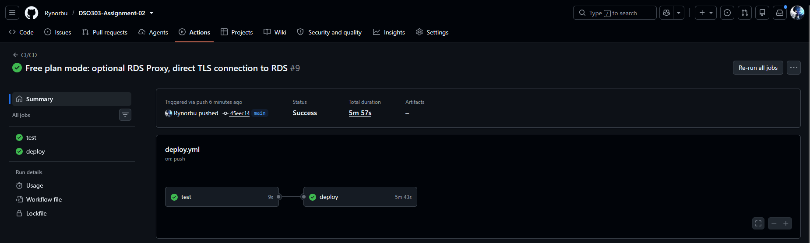 |  |

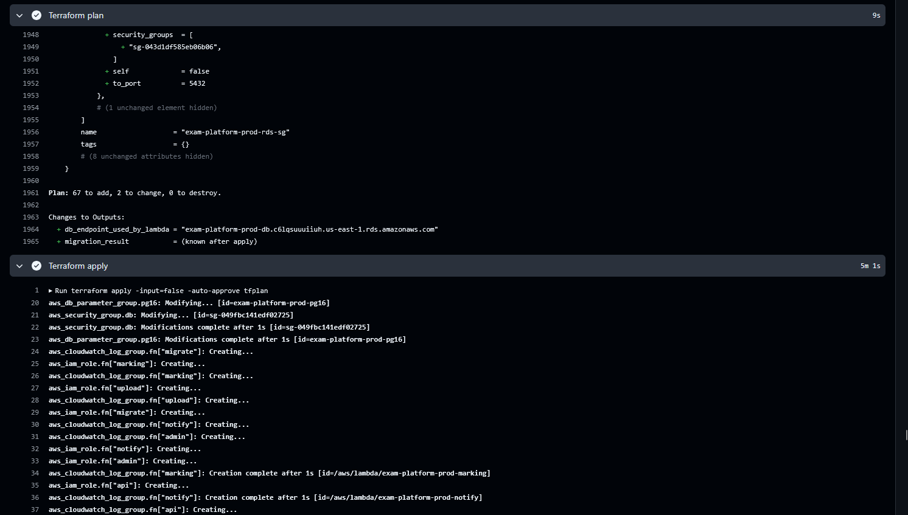

**Tear-down from code:** the *Tear down* workflow ([`destroy.yml`](../.github/workflows/destroy.yml)) runs `terraform destroy` after typing `DESTROY`. It succeeded:

After the teardown no `exam-platform-prod` NAT gateways or databases remain. The `yonten-*` resources in [`resource-gone.png`](aws-console/resource-gone.png) and [`resource-gone-1.png`](aws-console/resource-gone-1.png) belong to another student's project in the shared class account.

---

## 4. Local run (supporting)

The same Lambda code runs locally with PostgreSQL in Docker ([`docker-ps.png`](local-test/docker-ps.png), [`local-service-running.png`](local-test/local-service-running.png)), 11 unit tests pass ([`unit-tests.png`](local-test/unit-tests.png)), and both walkthroughs work locally ([`student-taking-exam.png`](local-test/student-taking-exam.png), [`auto-save.png`](local-test/auto-save.png), [`assignment-submitted.png`](local-test/assignment-submitted.png), [`database-row.png`](local-test/database-row.png)).
